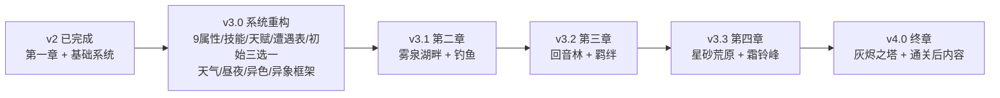

# 焰迹旅人 · v3 策划总览

**作者：** 周建豪  
**日期：** 2026-10-14  
**状态：** 已评审 · v3.0 已实现并自测通过（2026-10-14，见根目录 `test_report_20261014_1622.md`）；v3.1+（第二～四章、U04～U12）待开发  
**适用版本：** v3.0 ～ v4.0

---

## 1. 设计支柱（所有系统都要服务于这三点）

| 支柱 | 含义 | 落地检验 |
|------|------|----------|
| **一眼看懂，越玩越深** | 小白 30 秒上手；老玩家能研究配队、天赋、技能组合 | 新手只靠「克制箭头」就能赢第一章；通关后仍有刷天赋/全图鉴目标 |
| **每只伙伴都有故事** | 伙伴不是数值块，而是有来历、有性格、有羁绊剧情的角色 | 每个物种都有图鉴传说；初始伙伴与守护兽有专属剧情 |
| **短篇体量，完整弧光** | 5 章主线 + 终章，约 4～6 小时通关，有起承转合与反派救赎 | 每章 40～60 分钟，有地图、宿敌、守护兽、章节奖励 |

## 2. 策划稿目录

| 文档 | 内容 |
|------|------|
| `01-世界观与主线剧情.md` | 世界设定、反派、5 章 + 终章剧情、NPC、支线 |
| `02-属性克制.md` | 4 → 9 属性、9×9 克制表、设计逻辑、平衡校验 |
| `03-伙伴图鉴.md` | 11 → 44 种伙伴：属性、稀有度、进化链、栖息地、传说、羁绊剧情 |
| `04-遭遇系统.md` | 每步遇敌公式、遭遇权重、稀有保底、异色、钓鱼/洞窟、香与铃 |
| `05-天赋与性格.md` | 四维资质、天赋评级 D～S、性格、特性、天赋觉醒 |
| `06-技能系统.md` | 命中、PP、先制、状态异常、能力阶级、54 个技能 + 3 个羁绊技 |
| `07-实施路线.md` | 版本拆分、数据结构、存档迁移、验收标准 |
| `08-天气昼夜与随机大事件.md` | 动态天气、昼夜与满月、随机大事件（异象）、12 只唯一精灵、小事件 |

## 3. 版本全景

## 4. 章节等级曲线（全局数值锚点）

所有数值（野生等级、训练家、守护兽、经验曲线）都以此表为准。

| 章节 | 区域 | 野生等级 | 宿敌/训练家 | 守护兽 Lv | 玩家预期队伍 Lv |
|------|------|----------|-------------|-----------|-----------------|
| 序章 | 晨曦小镇 / 青苔草地 | 3～6 | 巡护员苔 5 | — | 5～8 |
| 第一章 | 余烬山道 | 8～11 | 登山客峰 9 | 熔鬃狮 13 | 10～13 |
| 第二章 | 雾泉湖畔 | 13～17 | 熄灯会·斥候 15 | 沧澜鲸 20 | 17～20 |
| 第三章 | 回音林 | 18～23 | 熄灯会·执灯 21 | 林语鹿 26 | 23～26 |
| 第四章 | 星砂荒原 / 霜铃峰 | 24～30 | 熄灯会·双子 28 | 雷鸣隼 33 | 30～33 |
| 终章 | 灰烬之塔 | 31～36 | 墨尘 38 | 曦焰凤 40 | 36～40 |
| 通关后 | 全地图 + 星砂秘境 | 35～45 | 冠军重赛 | 星砂猫 45 | 45～50 |

**等级上限：** 50。

## 5. 评审时需要你拍板的问题

见各文档末尾「待决策」小节，汇总如下：

1. 属性扩到 **9 种**（推荐），还是先扩到 6 种？
2. 技能是否引入 **PP（使用次数）**？推荐引入，回血点同时回满 PP。
3. 新开局是否改为 **初始伙伴三选一**（焰/潮/叶）？推荐。
4. 资质数值是 **直接可见**，还是需要小镇「鉴定师」揭示？推荐评级（D～S）直接可见，具体数值需鉴定。
5. ~~是否加入异色伙伴~~ → **已确认：加入**（1/400）。

**评审已确认（2026-10-14）：** 天气、昼夜、异色全部要做；新增「地图随机大事件」，每种大事件产生一只全存档唯一的精灵（详见 08）。

**评审结论（全部采纳推荐方案）：** 9 种属性 · 引入 PP · 初始三选一 · 评级可见数值需鉴定 · 异象失败冷却 3 天 · 日蚀需集齐 11 只唯一精灵。**状态：v3.0 已完成。**
