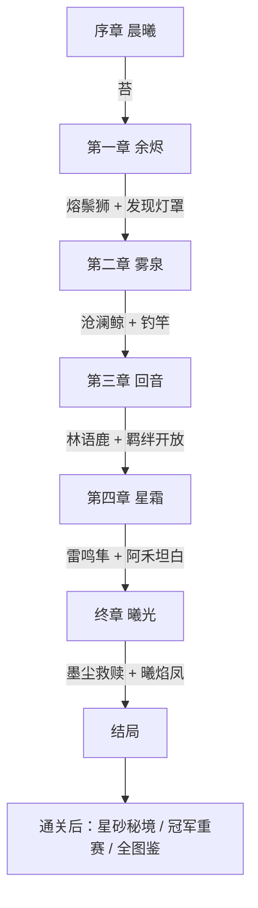

# 01 · 世界观与主线剧情

**作者：** 周建豪 · **日期：** 2026-10-14 · **状态：** 策划稿

---

## 1. 世界观一句话

> 大地之下流淌着「心火」，它从五座「灯台」涌出，滋养草木、温暖湖泊、唤醒伙伴。
> 如今灯台接连失控，有人说该把火彻底熄灭——而你，是被火种选中的「焰迹旅人」。

### 1.1 核心设定

| 设定 | 说明 | 玩法映射 |
|------|------|----------|
| **心火** | 世界的生命能量，伙伴的力量来源 | 属性、技能、进化的统一解释 |
| **五座灯台** | 焰、潮、叶、雷、灵 五座，各有守护兽 | 每章一座灯台 = 一个章节 BOSS |
| **焰迹** | 旅人走过的地方会留下微光足迹 | 标题与主角身份；结局彩蛋：回看全程足迹 |
| **伙伴** | 心火凝成的生灵，会与人缔结「羁绊」 | 收服、羁绊剧情、羁绊技 |
| **熄灯会** | 主张熄灭所有灯台的组织 | 贯穿全篇的宿敌 |

### 1.2 主题

**「火会伤人，也会温暖人；不是该不该点火，而是谁来守护它。」**
全篇围绕「失去 → 恐惧 → 守护」展开：反派因失去而恐惧，主角因羁绊而守护。

---

## 2. 主要角色

| 角色 | 定位 | 性格关键词 | 关键剧情 |
|------|------|------------|----------|
| **你（焰迹旅人）** | 主角，沉默型 | 由玩家投射 | 序章被火种选中 |
| **旅长阿禾** | 导师 | 慈祥、愧疚 | 墨尘的旧师父，终章揭示往事 |
| **墨尘** | 熄灯会首领 / 最终宿敌 | 冷静、偏执、温柔的底色 | 十年前山火中失去伙伴「灯灯」 |
| **小路** | 小镇孩子 / 吉祥物 | 好奇、话多 | 每章回镇有新台词，终章带来全镇的灯 |
| **疗愈师岚** | 治疗与后勤 | 温和 | 第二章起提供「鉴定」服务（天赋揭示） |
| **巡护员苔** | 第一位对手 → 盟友 | 正直、爱说教 | 第三章在回音林协助你 |
| **泉守汐** | 雾泉守护者 | 安静、守旧 | 第二章关键 NPC |
| **执灯·绯 / 双子·朔与望** | 熄灯会干部 | 各有动机 | 分别在三、四章对决，可被感化 |

### 2.1 反派弧光：墨尘

**设计要点：** 墨尘从未伤害无辜伙伴；他的伙伴「墨烬鸦」其实是灯灯的心火残片所化——终章揭示，形成情绪高点。

---

## 3. 主线章节

### 序章 · 晨曦（已实现）

- **地点：** 晨曦小镇、青苔草地
- **节拍：** 醒来 →（v3 新增）在阿禾家**三选一**初始伙伴 → 草地第一次收服 → 击败巡护员苔
- **结尾钩子：** 山方向传来低吼，天空泛红

### 第一章 · 余烬（已实现，v3 补强剧情）

- **地点：** 余烬山道
- **守护兽：** 熔鬃狮（焰）Lv13
- **v3 新增节拍：**
  1. 山道入口遇到 **熄灯会斥候**（首次登场，不战斗，只留下黑色灯罩）
  2. 登山客峰战后提示「这几天有黑衣人上山」
  3. 击败熔鬃狮后，**发现灯台上被盖了一半的灯罩** → 揭示躁动是人为
- **章节奖励：** 焰之徽记（焰属性招式威力 +10%）、解锁地图「雾泉湖畔」

### 第二章 · 雾泉

- **地点：** 雾泉湖畔（新地图，含湖面钓鱼点、湖心小岛）
- **核心冲突：** 湖面结了一层不自然的冰，雾泉螈们都躲起来了
- **节拍：**
  1. 泉守汐求助：湖心灯台被黑色灯罩罩住
  2. 获得**钓竿**（新遭遇方式），钓上受惊的泡泡鱼，引出支线
  3. 与熄灯会斥候 ×2 连战（第一次「连续训练家战」）
  4. 乘雾泉螈群搭成的浮桥前往湖心
  5. 守护兽 **沧澜鲸（潮）Lv20** —— 它不是敌人，是被灯罩折磨到失控
- **章节奖励：** 潮之徽记、钓竿升级为「好钓竿」、解锁回音林
- **情绪点：** 战后沧澜鲸用尾鳍在湖面写出「谢谢」

### 第三章 · 回音

- **地点：** 回音林（迷宫型森林，声音会「回响」误导方向）
- **核心冲突：** 林中伙伴集体失去声音
- **节拍：**
  1. 巡护员苔作为盟友登场，**临时组队**（苔的伙伴替你战斗一场）
  2. 解谜：按「回声顺序」踩响四块音石开启深林
  3. 干部 **执灯·绯** 对决（三只队伍）——绯曾是孤儿，被墨尘收留
  4. 绯战败后不撤退，而是说出墨尘的往事碎片
  5. 守护兽 **林语鹿（叶）Lv26**
- **章节奖励：** 叶之徽记、**羁绊系统正式开放**（亲密度可视化）
- **反派信息揭露：** 30%（墨尘失去过伙伴）

### 第四章 · 星霜

- **地点：** 星砂荒原（开阔，雷属性）→ 霜铃峰（攀登，霜/风属性）
- **核心冲突：** 雷鸣隼被困在不断落雷的荒原中心
- **节拍：**
  1. 荒原：沙暴天气（每 30 步一次，遇敌率 ×1.3）
  2. 霜铃峰：冰面滑行谜题（一直滑到撞墙）
  3. 干部 **双子·朔与望** **双打对决**（2v2，唯一一场双打）
  4. 守护兽 **雷鸣隼（雷）Lv33**
  5. 阿禾赶来，**坦白墨尘是他的学徒**，十年前的山火他也有责任
- **章节奖励：** 雷之徽记、星砂护符（异色率 ×1.5）
- **反派信息揭露：** 80%

### 终章 · 曦光

- **地点：** 灰烬之塔（5 层，每层对应一种已收复的灯台属性考验）
- **节拍：**
  1. 小路带着全镇的灯来送行（全镇 NPC 台词变化）
  2. 塔内 4 层守关（熄灯会精英 + 环境谜题）
  3. 顶层：**墨尘 Lv38**（4 只队伍，王牌：夜幕鸦）
  4. 战斗中途剧情：夜幕鸦身上浮现灯灯的火光 → 墨尘动摇
  5. 第五座灯台（灵）苏醒，**曦焰凤 Lv40** 降临——对战守护而非击倒（坚持 8 回合或击败）
  6. 结局：墨尘成为灵之灯台守护者；全图足迹亮起
- **结局分支（轻量）：** 若曾感化执灯·绯与双子，结局 CG 中三人一同点灯

---

## 4. 剧情流程图

---

## 5. 支线任务（10 个）

每个支线 5～10 分钟，奖励偏向「收集与养成」，不卡主线。

| # | 名称 | 章节 | 触发 | 内容 | 奖励 |
|---|------|------|------|------|------|
| 1 | 小路的翠叶狐 | 序章 | 和小路对话 3 次 | 在草地找到迷路的翠叶狐并带回 | 安抚果 ×3 |
| 2 | 登山客的护身符 | 一 | 击败登山客峰后 | 在灰烬草里找回掉落的护身符（随机格） | 好伤药 ×2 |
| 3 | 受惊的泡泡鱼 | 二 | 首次钓鱼 | 连续钓 5 次，安抚鱼群 | 技能书「泡沫护盾」 |
| 4 | 雾泉螈的蛋 | 二 | 湖心岛 | 走 200 步孵化 → 获得高资质雾泉螈 | 资质下限 12 的雾泉螈 |
| 5 | 回音石的歌 | 三 | 回音林 | 记住并复现 6 音旋律 | 铃铛猫（固定遭遇） |
| 6 | 菇菇派对 | 三 | 回音林深处 | 收集 8 种菇（散落道具点） | 资质果 ×1 |
| 7 | 星砂收集者 | 四 | 星砂荒原 | 交付 10 颗星砂（打荒原野生掉落） | 星砂护符 |
| 8 | 霜铃的回响 | 四 | 霜铃峰 | 冰滑谜题限定步数通关 | 霜晶蝶（固定遭遇，必定 A 级以上） |
| 9 | 灯灯的足迹 | 终章后 | 与墨尘对话 | 走遍墨尘与灯灯的旧地 5 处 | 墨尘赠送「微光灵」（S 级资质） |
| 10 | 冠军之路 | 通关后 | 小镇告示牌 | 连胜重赛：苔 → 峰 → 绯 → 双子 → 墨尘 | 称号「焰迹冠军」+ 金冠饰 |

---

## 6. NPC 台词进度规则（沿用 v2 `progressLines`）

所有关键 NPC 按以下旗标优先级切换台词（从上往下取第一个已达成）：

`game_cleared` > `ch4_clear` > `ch3_clear` > `ch2_clear` > `boss_beaten`（第一章）> `ranger_beaten` > 默认

小镇每章至少 3 位 NPC 有新台词，让玩家每次回镇都有「世界在变」的感受。

---

## 7. 待决策

1. 终章曦焰凤是「坚持 8 回合即胜」还是「必须击败」？推荐**坚持即胜**，主题更贴合「守护」。
2. 是否保留「连续训练家战」中途不回血的设计？推荐保留，但战前必有回血点。
