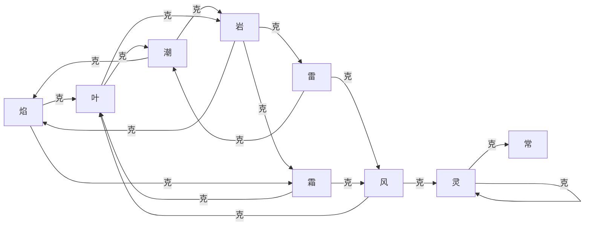

# 02 · 属性克制

**作者：** 周建豪 · **日期：** 2026-10-14 · **状态：** 策划稿

---

## 1. 设计目标

1. **小白能凭直觉猜对**：火烧草、水灭火、草吸水、石挡火、电导水、风吹叶、冰冻风……
2. **没有绝对的最强属性**：每个属性至少 1 个弱点、至少 1 个打不动的对象。
3. **兼容 v2**：原有 焰/潮/叶/岩 之间的倍率**一律不改**，第一章平衡与旧存档不受影响。
4. **不设免疫**：最低 0.5，保证任何招式都能造成伤害，避免新手卡死。

## 2. 九种属性

| 属性 | 英文 id | 主题色 | 意象 | 定位 |
|------|---------|--------|------|------|
| 常 | `normal` | `#d8c8b0` | 日常、毛绒 | 无弱点打法，稳定但无爆发 |
| 焰 | `flame` | `#ff8f6b` | 火种、余烬 | 高攻速，怕水怕石 |
| 潮 | `tide` | `#6eb8e8` | 湖泊、雾 | 均衡偏防 |
| 叶 | `leaf` | `#7bc96b` | 森林、花 | 打水打石，弱点最多 |
| 岩 | `stone` | `#c4a484` | 山石、甲壳 | 高防低速，进攻面最广 |
| 雷 | `volt` | `#f5d442` | 星砂、闪电 | 高速脆皮，只怕岩 |
| 风 | `gale` | `#b8e0f0` | 羽翼、云 | 高速，克叶与灵 |
| 霜 | `frost` | `#c8e8ff` | 冰晶、雪 | 克叶克风，怕火怕石 |
| 灵 | `spirit` | `#c8a8f0` | 心火、微光 | 剧情核心属性，克常与灵 |

> **改动说明：** v2 中「冲撞」被标为岩属性，v3 改为 **常** 属性。

## 3. 克制表（攻击方 → 防御方）

- **1.5** = 效果拔群 ▲ · **0.75** = 效果一般 ▽ · **0.5** = 几乎无效 ▼ · 空白 = 1.0

| 攻＼防 | 常 | 焰 | 潮 | 叶 | 岩 | 雷 | 风 | 霜 | 灵 |
|:--:|:--:|:--:|:--:|:--:|:--:|:--:|:--:|:--:|:--:|
| **常** | | | | | ▽0.75 | | | | ▼0.5 |
| **焰** | | ▽0.75 | ▽0.75 | ▲1.5 | ▽0.75 | | | ▲1.5 | |
| **潮** | | ▲1.5 | ▽0.75 | ▽0.75 | ▲1.5 | | | ▽0.75 | |
| **叶** | | ▽0.75 | ▲1.5 | ▽0.75 | ▲1.5 | | ▽0.75 | | |
| **岩** | | ▲1.5 | ▽0.75 | ▽0.75 | | ▲1.5 | | ▲1.5 | |
| **雷** | | | ▲1.5 | ▽0.75 | ▼0.5 | ▽0.75 | ▲1.5 | | |
| **风** | | | | ▲1.5 | ▽0.75 | ▽0.75 | | | ▲1.5 |
| **霜** | | ▽0.75 | ▽0.75 | ▲1.5 | | | ▲1.5 | ▽0.75 | |
| **灵** | ▲1.5 | ▽0.75 | | | | | | | ▲1.5 |

## 4. 记忆口诀（游戏内「旅长笔记」直接使用）

```
火烧草，草吸水，水灭火——三角最基本；
石头挡火又压雷，水草来了就认输；
雷打水来又打风，碰上石头没脾气；
风吹叶子散灵光，冰冻草叶冻住风；
灵光专克常与灵，心火一照便退让。
```

## 5. 关系图



## 6. 平衡校验

| 属性 | 进攻：克制几种 | 防守：弱点 | 防守：抵抗 | 结论 |
|------|:--:|------|------|------|
| 常 | 0 | 灵 | — | 进攻无爆发 → 常系招式威力 +10% 补偿 |
| 焰 | 2 | 潮、岩 | 焰、叶、霜、灵 | 均衡 |
| 潮 | 2 | 叶、雷 | 焰、潮、岩、霜 | 偏防守，符合定位 |
| 叶 | 2 | 焰、风、霜 | 潮、叶、雷、岩 | 弱点最多 → 叶系物种 HP 普遍 +10% |
| 岩 | 3 | 潮、叶 | 常、焰、雷(0.5)、风 | 最广进攻面 → 速度普遍最低 |
| 雷 | 2 | 岩 | 雷、风 | 防守最安全 → 雷系 HP/防普遍最低 |
| 风 | 2 | 雷、霜 | 叶 | 偏进攻 |
| 霜 | 2 | 焰、岩 | 潮、霜 | 偏进攻 |
| 灵 | 2 | 风、灵 | 常(0.5) | 剧情属性，种类少、稀有度高 |

**结论：** 没有属性同时「进攻面最广 + 弱点最少」；短板都通过物种基础值补偿，而不是改克制表。

## 7. 伤害公式中的属性项（沿用 v2，补充一条）

```
最终伤害 = 基础伤害 × 克制倍率 × 本系加成(1.2) × 会心(1.5) × 随机(0.9~1.1) × 徽记加成
```

- **本系加成（STAB）**：招式属性 = 自身属性时 ×1.2（v2 已实现）
- **徽记加成（新增）**：持有对应章节徽记，该属性招式 ×1.1

## 8. 环境与属性（第四章引入，轻量）

| 环境 | 地点 | 效果 |
|------|------|------|
| 雾 | 雾泉湖畔 | 潮系招式 ×1.1；所有招式命中 −5% |
| 沙暴 | 星砂荒原 | 每回合非 岩/雷 伙伴损失 1/16 HP |
| 霜雪 | 霜铃峰 | 霜系招式冻结几率 ×2 |
| 心火 | 灰烬之塔顶层 | 灵系与焰系招式 ×1.1 |

## 9. UI 呈现

- 出招菜单：保留 v2 的「▲效果拔群 / ▽效果一般」，新增「▼几乎无效」
- 图鉴：每个属性显示「克制 / 被克」小图标
- 旅长笔记（菜单新入口）：完整 9×9 表 + 口诀，第三章前只显示已遇见属性（防剧透）

## 10. 待决策

1. 是否接受「不设免疫」？推荐接受（短篇向，降低挫败感）。
2. 是否引入**双属性**？推荐 **v3 不引入**，v4 视需要给部分最终进化形态加第二属性。
