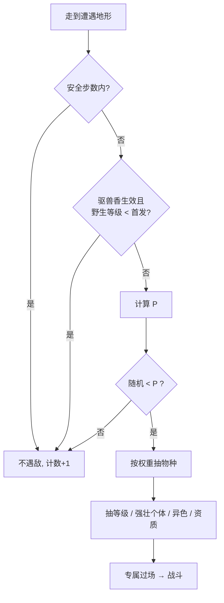

# 04 · 遭遇系统

**作者：** 周建豪 · **日期：** 2026-10-14 · **状态：** 策划稿

---

## 1. 设计目标

| 目标 | 手段 |
|------|------|
| 不烦人 | 战后安全步数、高等级碾压时降低遇敌率、驱兽香 |
| 不干旱 | 连续未遇敌时概率递增（保底） |
| 稀有有盼头 | 稀有种保底、引兽铃、昼夜/天气限定 |
| 收集有引导 | 未收服物种权重轻微上调 |
| 惊喜感 | 强壮个体、异色伙伴、专属过场 |

v2 现状：每步固定概率（草地 18%、山道 14%），战后 2 步安全，遭遇池均匀随机。v3 全面替换为下述规则。

---

## 2. 每步遇敌概率

```
P(本步遇敌) = 地形基础 × 道具修正 × 天气修正 × 碾压修正 × 干旱保底
```

| 项 | 取值 |
|----|------|
| **地形基础** | 高草 12% · 灰烬草 12% · 深林草 14% · 沙地 8% · 雪地 10% · 塔内地面 5% |
| **安全步数** | 进入地图 / 战斗结束后前 **3** 步不遇敌 |
| **干旱保底** | 每多走 1 步未遇敌 +2%（相对值），最多 ×2.0；遇敌后清零 |
| **碾压修正** | 首发等级 ≥ 该地图野生最高等级 +10 → ×0.5 |
| **道具修正** | 引兽铃 ×1.5（100 步）· 驱兽香：野生等级 < 首发等级则不遇敌（200 步） |
| **天气修正** | 沙暴 ×1.3 · 雾 ×1.1 · 其他 ×1.0 |

**示例：** 青苔草地高草，走到第 10 步仍未遇敌 → 12% × (1 + 0.02×7) ≈ 13.7%。



---

## 3. 物种抽取

### 3.1 权重

每张地图有一张遭遇表，单物种权重按稀有度给出基础值，然后应用修正：

| 稀有度 | 基础权重 |
|--------|---------|
| 常见 ● | 30～40 |
| 少见 ◆ | 12～20 |
| 稀有 ★ | 3～5 |

| 修正 | 规则 |
|------|------|
| **图鉴引导** | 未收服物种 ×1.2 |
| **稀有保底** | 本地图连续 30 次遇敌未出 ★ → ★ 权重 ×3，直到遇到为止 |
| **引兽铃** | ★ 权重 ×2 |
| **昼夜** | 限定物种在非对应时段权重 = 0 |

### 3.2 等级与强壮个体

- 等级在 `[minLv, maxLv]` 中均匀抽取
- **强壮个体**：10% 机率，等级 +2、资质下限 +5；战斗开场名字前显示「强壮的」，场上有淡金色光环

### 3.3 异色伙伴

| 项 | 值 |
|----|----|
| 基础机率 | 1 / 400 |
| 星砂护符（第四章） | ×1.5 |
| 闪耀之冠（图鉴全收服） | ×2（可叠乘 → 1/133） |
| 异色特征 | 色相偏移配色 + 闪光粒子；资质下限 10；不影响种族值 |
| 演出 | 遇敌过场改为金色闪屏 + 专属音效「叮铃」 |

---

## 4. 昼夜（步数驱动，不依赖真实时间）

- 每 **600 步** 切换昼/夜，菜单显示 ☀ / ☾
- 夜晚：画面叠加深蓝滤镜（透明度 25%），NPC 台词少量变化
- 夜行物种：烬尘蛾、炎羽蛾、旋叶蝠、微光灵（夜晚权重 ×2；白天为 0 或降低）

> 选择步数驱动是为了让玩家可控、可复现，也避免「现实时间晚上才能抓」这类挫败。

---

## 5. 遭遇方式

| 方式 | 解锁 | 规则 |
|------|------|------|
| 草丛类地形 | 默认 | 每步按第 2 节公式 |
| **钓鱼** | 第二章钓竿 | 面朝水面按确认；1～3 秒后出现「！」，0.6 秒内按确认上钩；成功率 85% |
| 冰面 | 第二章 | 冰面滑行中不遇敌，停下的格子按 10% 判定 |
| 定点遭遇 | 支线 | 地图上可见的伙伴，对话后进入战斗（铃铛猫、霜晶蝶、守护兽重战） |
| 剧情赠送 | 主线/支线 | 蛋孵化、墨尘赠送等，不走遭遇表 |

---

## 6. 各地图遭遇表

> 权重为基础值（未叠加修正）。☾ = 仅夜晚。

### 青苔草地（序章，Lv 3～6）

| 物种 | 稀 | 权重 | 等级 |
|------|:--:|:--:|:--:|
| 绒团鼠 | ● | 35 | 3～5 |
| 翠叶狐 | ● | 25 | 3～6 |
| 云雀羽 | ● | 20 | 3～5 |
| 岩甲虫 | ● | 15 | 3～5 |
| 碧波龟 | ◆ | 12 | 4～6 |
| 芽芽菇 | ◆ | 10 | 4～6 |

### 余烬山道（第一章，Lv 8～11）

| 物种 | 稀 | 权重 | 等级 |
|------|:--:|:--:|:--:|
| 岩甲虫 | ● | 30 | 8～10 |
| 砾团犬 | ◆ | 20 | 8～10 |
| 灯芯蜥 | ◆ | 18 | 8～11 |
| 雾泉螈 | ◆ | 15 | 8～10 |
| 烬尘蛾 ☾ | ◆ | 20 | 9～11 |

### 雾泉湖畔（第二章，Lv 13～17）

| 来源 | 物种 | 稀 | 权重 | 等级 |
|------|------|:--:|:--:|:--:|
| 草丛 | 云雀羽 | ● | 30 | 13～15 |
| 草丛 | 雾泉螈 | ◆ | 20 | 13～16 |
| 草丛 | 碧波龟 | ◆ | 15 | 14～16 |
| 冰面 | 霜粒鹅 | ◆ | 100（冰面唯一） | 14～17 |
| 钓竿 | 泡泡鱼 | ● | 80 | 12～15 |
| 钓竿 | 雾泉螈 | ◆ | 20 | 13～15 |
| 好钓竿 | 珊冠鱼 | ● | 60 | 16～18 |
| 好钓竿 | 澜鳍螈 | ◆ | 30 | 17～19 |
| 好钓竿 | 碧波龟 | ★ | 10 | 18～20 |

### 回音林（第三章，Lv 18～23）

| 物种 | 稀 | 权重 | 等级 |
|------|:--:|:--:|:--:|
| 蓬尾鼠 | ● | 30 | 18～21 |
| 芽芽菇 | ● | 30 | 18～20 |
| 伞灵菇 | ◆ | 15 | 21～23 |
| 翠叶狐 | ◆ | 12 | 18～21 |
| 旋叶蝠 ☾ | ◆ | 20 | 19～22 |
| 微光灵 ☾ | ★ | 4 | 20～22 |

### 星砂荒原（第四章上，Lv 24～28）

| 物种 | 稀 | 权重 | 等级 |
|------|:--:|:--:|:--:|
| 电绒团 | ● | 35 | 24～26 |
| 砾团犬 | ● | 25 | 24～27 |
| 磐甲虫 | ◆ | 15 | 25～28 |
| 雷绒獾 | ◆ | 12 | 26～28 |
| 炎羽蛾 ☾ | ◆ | 15 | 26～28 |

### 霜铃峰（第四章下，Lv 26～30）

| 物种 | 稀 | 权重 | 等级 |
|------|:--:|:--:|:--:|
| 霜粒鹅 | ● | 35 | 26～28 |
| 穹翼雀 | ◆ | 20 | 27～30 |
| 岩鬃犬 | ◆ | 15 | 27～30 |
| 冰冕鹅 | ◆ | 10 | 28～30 |

### 灰烬之塔（终章，Lv 31～36，塔内地面 5%）

| 物种 | 稀 | 权重 | 等级 |
|------|:--:|:--:|:--:|
| 焰灯蜥 | ◆ | 30 | 31～34 |
| 萤灯灵 | ◆ | 20 | 32～35 |
| 微光灵 | ◆ | 20 | 31～33 |
| 墨烬鸦（通关后） | ◆ | 25 | 33～36 |

### 星砂秘境（通关后，Lv 35～45）

全 9 属性二阶物种混合池，★ 权重统一 8；最深处定点遭遇 **星砂猫 Lv45**。

---

## 7. 战斗前反馈（让玩家「感觉到」稀有）

| 情况 | 地图上 | 过场 |
|------|--------|------|
| 普通 | 草丛摇晃（v2 已有） | 白闪 ×2 |
| 强壮个体 | 草丛摇晃 + 淡金色 | 白闪 + 金边 |
| 稀有 ★ | 草丛闪一下星光 | 白闪 + 星形转场 |
| 异色 | 叮铃音效 | 全屏金闪 + 星形转场 |

---

## 8. 数据结构草案

```ts
/** 单条遭遇条目 */
interface EncounterEntry {
  speciesId: string
  weight: number
  minLv: number
  maxLv: number
  /** 仅昼 / 仅夜 / 不限 */
  time?: 'day' | 'night'
}

/** 地图遭遇配置（替换 v2 的 wildChance + wildPool） */
interface EncounterTable {
  grass?: EncounterEntry[]
  fishing?: EncounterEntry[]
  goodRod?: EncounterEntry[]
  ice?: EncounterEntry[]
  /** 地形基础概率覆盖 */
  baseRate?: number
}
```

存档新增：`stepsSinceEncounter`、`rarePity: Record<mapId, number>`、`dayStep`、`repelSteps`、`lureSteps`。

---

## 9. 待决策

1. ~~昼夜是否引入~~ → **已确认引入**，并新增动态天气与随机大事件，详见 `08-天气昼夜与随机大事件.md`（天气修正以 08 为准）。
2. 钓鱼是否做「按键反应」小游戏？推荐做（0.6 秒窗口，失败可立刻重试，不惩罚）。
