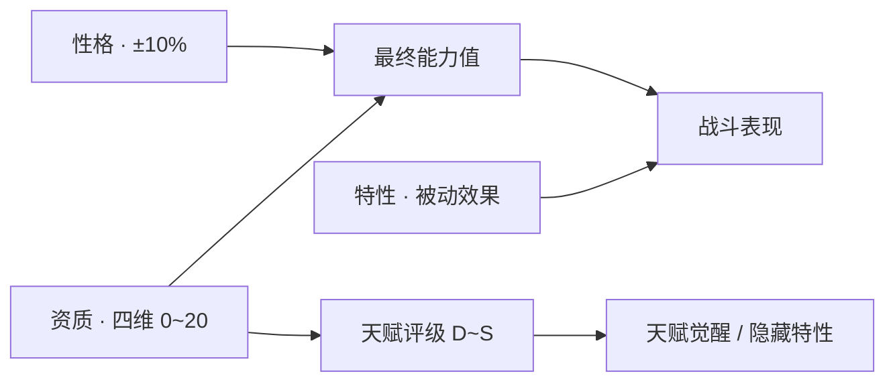

# 05 · 天赋与性格

**作者：** 周建豪 · **日期：** 2026-10-14 · **状态：** 策划稿

---

## 1. 设计目标

- **同一物种也有个体差异**，让「再抓一只」有意义
- **差距可感知但不碾压**：顶级个体比平庸个体强约 20%，靠操作和克制仍能逆转
- **对小白透明**：只看字母评级 D～S 就够了；进阶玩家可鉴定具体数值
- **刻意不做「努力值」**：短篇体量下，隐藏养成数值的学习成本过高

## 2. 养成三要素



---

## 3. 资质（Talent）

### 3.1 定义

每只伙伴在生成时，对 **HP / 攻 / 防 / 速** 各掷一个资质值 **0～20**。

```
单项资质 = 下限 + 取整( (rand + rand) / 2 × (20 − 下限 + 1) )
```

取两次随机的平均（三角分布），让中间值更常见、极端值稀少。

### 3.2 资质下限

| 来源 | 下限 |
|------|------|
| 普通野生 | 0 |
| 稀有 ★ 野生 | 5 |
| 强壮个体 | +5（与其他来源取最大后再加） |
| 初始伙伴 | 8 |
| 异色 | 10 |
| 守护兽 / 蛋孵化 | 12 |
| 传说 | 15 |

### 3.3 天赋评级

按四项资质总和（0～80）评级：

| 评级 | 总和 | 普通野生出现率（约） | 能力倍率区间 | UI |
|:--:|:--:|:--:|:--:|------|
| **D** 平庸 | 0～27 | 15% | 0.90～0.97 | 灰色 |
| **C** 寻常 | 28～43 | 40% | 0.97～1.01 | 白色 |
| **B** 优秀 | 44～57 | 38% | 1.01～1.04 | 绿色 |
| **A** 卓越 | 58～69 | 6.5% | 1.04～1.07 | 蓝色 |
| **S** 天选 | 70～80 | 0.5% | 1.07～1.10 | 金色 + 星框 |

> 出现率为估算值，实现时需用 10 万次模拟校验并微调。

### 3.4 对能力值的影响

在 v2 公式基础上乘一个资质系数：

```
能力值 = round( 种族值 × (1 + (Lv − 1) × 0.08) × (0.9 + 资质 × 0.01) × 性格修正 )
```

- 资质 0 → ×0.90；资质 20 → ×1.10
- **同物种 S 与 D 的差距约 20%**，满足「可感知但不碾压」

### 3.5 可见性

| 信息 | 何时可见 |
|------|----------|
| 天赋评级字母 | 始终可见（队伍、图鉴、战斗信息框） |
| 四项具体数值 | 疗愈师岚「鉴定」后可见（第二章起免费） |
| 四项星级（★～★★★★★） | 鉴定后在伙伴详情显示，每 4 点资质 1 星 |

### 3.6 培养道具

| 道具 | 效果 | 获取 | 限制 |
|------|------|------|------|
| 资质果 | 指定一项资质 +2（上限 20） | 支线、星砂秘境掉落 | 每只伙伴最多 5 次 |
| 重塑露 | 四项资质按原下限重掷 | 通关后商店 2000 焰币 | 不可撤销，使用前二次确认 |
| 鉴定（服务） | 显示具体数值 | 疗愈师岚 | 免费 |

---

## 4. 天赋觉醒

评级 **A 或 S** 的伙伴到达 **Lv25** 时触发「天赋觉醒」：

| 评级 | 觉醒效果 |
|:--:|------|
| A | 四项能力 +3%；名称旁出现蓝色小火苗标识 |
| S | 四项能力 +5%；**解锁隐藏特性**（见第 6 节）；金色火苗标识 |

觉醒时在战斗或回血点播放 1 句专属台词，例如：「焰角兔额角的火种，燃成了金色。」

---

## 5. 性格（Nature）

### 5.1 九种性格

一项能力 +10%、另一项 −10%，「平和」无修正。性格同时影响**亲密度成长**和**羁绊台词语气**。

| 性格 | 提升 | 降低 | 亲密度成长 | 台词语气示例 |
|------|:--:|:--:|:--:|------|
| 平和 | — | — | ×1.0 | 「我们出发吧。」 |
| 勇敢 | 攻 | 速 | ×1.0 | 「冲在最前面的是我！」 |
| 固执 | 攻 | 防 | ×0.9 | 「哼，我自己也行。」 |
| 稳重 | 防 | 速 | ×1.1 | 「别急，慢慢来。」 |
| 淘气 | 防 | 攻 | ×1.1 | 「嘿嘿，抓不到我～」 |
| 急躁 | 速 | 防 | ×0.9 | 「快点快点！」 |
| 活泼 | 速 | 攻 | ×1.2 | 「今天也超开心！」 |
| 坚韧 | HP | 速 | ×1.0 | 「这点伤不算什么。」 |
| 温柔 | HP | 攻 | ×1.2 | 「你累了吗？靠着我吧。」 |

### 5.2 获取与调整

- 生成时均匀随机
- 通关后小镇新增「性格薄荷」（可将修正改为任一性格，500 焰币）

---

## 6. 特性（Ability）

每个物种有 **2 个普通特性**（生成时二选一）+ **1 个隐藏特性**（仅 S 级觉醒 / 异色 / 守护兽可获得）。

### 6.1 特性库（24 个）

| 特性 | 效果 | 典型持有 |
|------|------|----------|
| 焰心 | HP < 1/3 时焰系招式 ×1.3 | 焰系初始线 |
| 激流 | HP < 1/3 时潮系招式 ×1.3 | 潮系初始线 |
| 茂盛 | HP < 1/3 时叶系招式 ×1.3 | 叶系初始线 |
| 坚甲 | 受到「效果拔群」伤害 ×0.8 | 岩甲虫、碧波龟 |
| 迅捷 | 速度 +10% | 云雀羽、电绒团 |
| 静电 | 被接触类招式命中时 25% 令对手麻痹 | 电绒团线 |
| 火焰体 | 被接触类招式命中时 25% 令对手灼烧 | 焰灯蜥、熔鬃狮 |
| 冰肤 | 被接触类招式命中时 15% 令对手冻结 | 霜粒鹅线 |
| 好运 | 会心率翻倍（1/16 → 1/8） | 铃铛猫、星砂猫 |
| 自愈 | 每回合结束回复 1/16 HP | 芽芽菇线、沧澜鲸 |
| 毛绒 | 受到接触伤害 ×0.75，受焰系伤害 ×1.25 | 绒团鼠线 |
| 胆怯 | 野生战逃跑必定成功 | 绒团鼠、泡泡鱼 |
| 引路 | 作为首发时稀有物种权重 ×1.5 | 灯芯蜥、微光灵 |
| 驱散 | 作为首发时遇敌率 ×0.7 | 旋叶蝠 |
| 水泡 | 潮系招式 ×1.2，不会灼烧 | 泡泡鱼线 |
| 回响 | 连续使用同一招式时威力每次 +10%（最多 +30%） | 林语鹿、旋叶蝠 |
| 威吓 | 出场时对手攻击 −1 阶 | 岩鬃犬、熔鬃狮 |
| 顺风 | 出场后 3 回合己方速度 +1 阶 | 穹翼雀、雷鸣隼 |
| 雪隐 | 霜雪环境下闪避 +10% | 冰冕鹅、霜晶蝶 |
| 微光 | 灵系招式命中时 20% 令对手混乱 | 微光灵线 |
| 余烬 | 倒下时对对手造成其最大 HP 1/8 伤害 | 烬尘蛾、墨烬鸦 |
| 守护者 | 每场战斗首次受致命伤时残留 1 HP | 所有守护兽（隐藏） |
| 涅槃 | 每场战斗限一次，倒下时以 50% HP 复活 | 曦焰凤（隐藏） |
| 同心 | 亲密度 ≥ 220 时全能力 +5% | 三只初始伙伴（隐藏） |

### 6.2 物种特性分配（示例，完整表实现时落到数据文件）

| 物种 | 普通特性 A | 普通特性 B | 隐藏特性 |
|------|-----------|-----------|----------|
| 焰角兔线 | 焰心 | 迅捷 | 同心 |
| 碧波龟线 | 激流 | 坚甲 | 同心 |
| 翠叶狐线 | 茂盛 | 迅捷 | 同心 |
| 岩甲虫线 | 坚甲 | 威吓 | 自愈 |
| 电绒团线 | 静电 | 迅捷 | 好运 |
| 微光灵线 | 微光 | 引路 | 自愈 |
| 墨烬鸦线 | 余烬 | 迅捷 | 微光 |
| 熔鬃狮 | 火焰体 | 威吓 | 守护者 |
| 曦焰凤 | 焰心 | 微光 | 涅槃 |

---

## 7. 展示（UI）

**伙伴详情页布局：**

```
┌──────────────────────────────────┐
│ [立绘]  焰角兔  Lv.12  [焰]  天赋 A │
│         性格：活泼（速↑ 攻↓）        │
│         特性：焰心                  │
│ HP  ★★★★☆  攻 ★★★☆☆               │
│ 防  ★★☆☆☆  速 ★★★★★               │
│ 亲密度 ♥♥♥♡♡  （信赖）              │
│ 招式：火星踢 / 余烬唾 / 焰流冲 / 冲撞 │
└──────────────────────────────────┘
```

- 战斗信息框名字后加评级字母（颜色区分）
- 收服成功时弹出「天赋 A！」等提示，S 级附带金光与音效

---

## 8. 数据结构草案

```ts
type StatKey = 'hp' | 'atk' | 'def' | 'spd'
type NatureId = 'calm' | 'brave' | 'stubborn' | 'steady' | 'naughty' | 'hasty' | 'lively' | 'tough' | 'gentle'

/** 新增到 CreatureInstance */
interface TalentFields {
  talent: Record<StatKey, number>   // 0~20
  nature: NatureId
  abilityId: string
  appraised: boolean                // 是否已鉴定
  awakened: boolean                 // 是否已天赋觉醒
  shiny: boolean
  friendship: number                // 0~255
  fruitUsed: number                 // 已用资质果次数
}
```

**旧存档迁移：** v2 伙伴补发资质（下限 8，等同初始伙伴待遇）、随机性格、特性取 A，亲密度按等级 × 5 估算。

---

## 9. 待决策

1. 资质数值需要鉴定才能看，还是一开始就全部可见？推荐**评级始终可见，数值需鉴定**（保留一点揭晓的乐趣）。
2. 是否保留「重塑露」？它会让 S 级变得可刷。推荐保留，但仅通关后出售且价格高。
