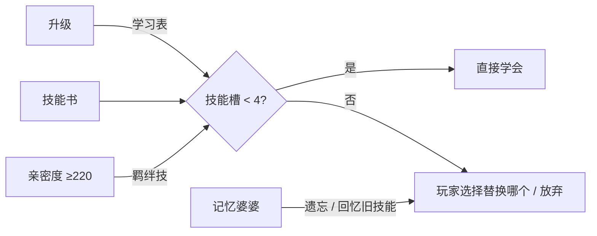

# 06 · 技能系统

**作者：** 周建豪 · **日期：** 2026-10-14 · **状态：** 策划稿

---

## 1. 设计目标

- **从「比谁威力大」升级为「每回合都有选择」**：伤害、状态、强化、回复、先制，各有用武之地
- **四个技能槽是一套构筑**：一只伙伴的技能组合应体现「它是谁」
- **v2 已有的 17 个招式全部保留**（id 与威力不变），存档无缝过渡

## 2. 技能字段

| 字段 | 说明 |
|------|------|
| 属性 | 9 种之一（见 02 属性克制） |
| 类别 | **攻击**（造成伤害）/ **变化**（状态、强化、回复） |
| 威力 | 沿用 v2 量级：12～45 |
| 命中 | 75～100%，「必中」无视闪避 |
| PP | 5 / 10 / 15 / 25 / 35，用完不能再选 |
| 优先度 | −1 / 0 / +1；同优先度按速度先后 |
| 附加效果 | 概率触发的状态或能力变化 |
| 接触 | 是否为接触类（影响静电、火焰体等特性） |

**不做物攻/特攻区分**：攻击统一走「攻 vs 防」，降低理解成本。

---

## 3. 伤害公式

沿用 v2 基础伤害，按以下顺序叠乘修正：

```
伤害 = v2基础伤害
     × 本系加成 1.2
     × 属性克制（1.5 / 1 / 0.75 / 0.5，见 02）
     × 会心 1.5（1/16，好运或羽刃 1/8）
     × 能力阶段倍率
     × 特性修正
     × 环境修正（天气、心火、徽记 ×1.1）
     × 随机 0.9～1.1
最小伤害 1
```

### 3.1 能力阶段

攻 / 防 / 速 可各自升降，范围 **−3～+3**，换下场后清零。

| 阶段 | −3 | −2 | −1 | 0 | +1 | +2 | +3 |
|------|:--:|:--:|:--:|:--:|:--:|:--:|:--:|
| 倍率 | ×0.57 | ×0.67 | ×0.8 | ×1 | ×1.25 | ×1.5 | ×1.75 |

---

## 4. 异常状态

同一时间只能有 **1 种主状态**；混乱、寄生可与主状态叠加。

| 状态 | 类型 | 效果 | 解除 | 免疫 |
|------|------|------|------|------|
| 🔥 灼烧 | 主状态 | 每回合损失 1/16 最大 HP，攻 ×0.75 | 灼烧药、回血点 | 焰系 |
| ⚡ 麻痹 | 主状态 | 速 ×0.5，25% 无法行动 | 解麻药、回血点 | 雷系 |
| ❄ 冻结 | 主状态 | 无法行动；每回合 25% 解冻；被焰系招式命中立即解冻 | 解冻药、回血点 | 霜系 |
| 🌱 寄生 | 附加 | 每回合被吸 1/8 最大 HP，回给对手场上伙伴 | 换下场 | 叶系 |
| 💫 混乱 | 附加 | 持续 2～4 回合，33% 攻击自己（威力 20 常系） | 自动结束、换下场 | 灵系 |

**万灵药**一次解除全部状态（商店 120 焰币）。

---

## 5. 技能列表（54 个 + 羁绊技 3 个 + 挣扎）

> ★ = v2 已有招式（id 与威力不变）；**专属** = 只有特定伙伴能学

### 5.1 常 · 普通

| 技能 | 类别 | 威力 | 命中 | PP | 效果 |
|------|:--:|:--:|:--:|:--:|------|
| ★ 冲撞 tackle | 攻 | 14 | 100 | 35 | 接触 |
| 快攻 quick_jab | 攻 | 12 | 100 | 30 | **优先度 +1**，接触 |
| 低吼 growl | 变 | — | 100 | 30 | 对手攻 −1 |
| 鼓舞 rally | 变 | — | — | 15 | 自身攻 +2 |
| 猛撞 body_slam | 攻 | 30 | 100 | 15 | 30% 麻痹，接触 |
| 舍身冲 double_edge | 攻 | 42 | 100 | 10 | 承受造成伤害 1/4 的反伤，接触 |

### 5.2 焰

| 技能 | 类别 | 威力 | 命中 | PP | 效果 |
|------|:--:|:--:|:--:|:--:|------|
| ★ 火星踢 spark_kick | 攻 | 18 | 100 | 25 | 接触 |
| ★ 余烬唾 ember_spit | 攻 | 22 | 100 | 25 | 10% 灼烧 |
| 鬼火 wisp_fire | 变 | — | 85 | 15 | 令对手灼烧 |
| ★ 焰流冲 flare_dash | 攻 | 30 | 95 | 15 | 接触 |
| ★ 烈焰爆 blaze_burst | 攻 | 38 | 90 | 10 | 10% 灼烧 |
| 晨曦烈焰 dawn_flare | 攻 | 45 | 90 | 5 | 30% 灼烧，**专属：曦焰凤** |

### 5.3 潮

| 技能 | 类别 | 威力 | 命中 | PP | 效果 |
|------|:--:|:--:|:--:|:--:|------|
| ★ 水花 splash | 攻 | 16 | 100 | 35 | — |
| ★ 泡泡滚 bubble_roll | 攻 | 24 | 100 | 25 | 10% 对手速 −1 |
| 潮愈 aqua_ring | 变 | — | — | 10 | 5 回合内每回合回复 1/16 HP |
| ★ 潮汐撞 tide_crash | 攻 | 30 | 95 | 15 | 接触 |
| ★ 激流 torrent | 攻 | 38 | 90 | 10 | — |
| 深海咆哮 abyss_roar | 攻 | 45 | 85 | 5 | 对手防 −1，**专属：沧澜鲸** |

### 5.4 叶

| 技能 | 类别 | 威力 | 命中 | PP | 效果 |
|------|:--:|:--:|:--:|:--:|------|
| ★ 叶拍 leaf_tap | 攻 | 17 | 100 | 35 | 接触 |
| ★ 藤鞭 vine_snap | 攻 | 23 | 100 | 25 | 接触 |
| 寄生种 leech_seed | 变 | — | 90 | 10 | 令对手寄生 |
| 光合 synthesis | 变 | — | — | 5 | 回复 50% HP（心火环境 66%） |
| ★ 花瓣风暴 petal_storm | 攻 | 30 | 95 | 15 | — |
| ★ 森林光束 grove_beam | 攻 | 38 | 90 | 10 | — |

### 5.5 岩

| 技能 | 类别 | 威力 | 命中 | PP | 效果 |
|------|:--:|:--:|:--:|:--:|------|
| ★ 碎石 pebble | 攻 | 19 | 100 | 30 | — |
| ★ 甲壳撞 shell_bash | 攻 | 25 | 100 | 20 | 接触 |
| 铁壁 iron_wall | 变 | — | — | 15 | 自身防 +2 |
| 沙暴 sandstorm | 变 | — | — | 5 | 召唤沙暴 5 回合（非岩系每回合损失 1/16 HP） |
| ★ 落石 rock_slide | 攻 | 30 | 90 | 15 | 20% 对手速 −1 |
| ★ 地震 quake | 攻 | 38 | 100 | 10 | — |

### 5.6 雷

| 技能 | 类别 | 威力 | 命中 | PP | 效果 |
|------|:--:|:--:|:--:|:--:|------|
| 电火花 spark | 攻 | 16 | 100 | 30 | 10% 麻痹，接触 |
| 电光一闪 volt_dash | 攻 | 14 | 100 | 30 | **优先度 +1**，接触 |
| 电磁波 thunder_wave | 变 | — | 90 | 15 | 令对手麻痹 |
| 雷牙 volt_fang | 攻 | 26 | 95 | 15 | 10% 麻痹，接触 |
| 雷霆 thunderbolt | 攻 | 36 | 100 | 10 | 10% 麻痹 |
| 雷鸣破 thunder_clap | 攻 | 45 | 80 | 5 | 30% 麻痹，**专属：雷鸣隼** |

### 5.7 风

| 技能 | 类别 | 威力 | 命中 | PP | 效果 |
|------|:--:|:--:|:--:|:--:|------|
| 疾风 gust | 攻 | 16 | 100 | 35 | — |
| 燕返 aerial | 攻 | 24 | 必中 | 20 | 接触 |
| 羽刃 feather_blade | 攻 | 28 | 95 | 15 | 会心率 1/8，接触 |
| 顺风 tailwind | 变 | — | — | 10 | 自身速 +2 |
| 吹散 defog | 变 | — | — | 15 | 清除对手能力提升与场上天气 |
| 暴风 hurricane | 攻 | 40 | 75 | 10 | 20% 混乱 |

### 5.8 霜

| 技能 | 类别 | 威力 | 命中 | PP | 效果 |
|------|:--:|:--:|:--:|:--:|------|
| 冰粒 ice_shard | 攻 | 14 | 100 | 30 | **优先度 +1** |
| 冰息 frost_breath | 攻 | 22 | 95 | 25 | 10% 冻结 |
| 冷雾 cold_mist | 变 | — | 95 | 15 | 对手速 −2 |
| 霜壁 frost_wall | 变 | — | — | 10 | 3 回合内己方受到伤害 ×0.5 |
| 冰柱 icicle | 攻 | 30 | 95 | 15 | 接触 |
| 暴风雪 blizzard | 攻 | 40 | 75 | 5 | 10% 冻结（霜雪环境必中） |

### 5.9 灵

| 技能 | 类别 | 威力 | 命中 | PP | 效果 |
|------|:--:|:--:|:--:|:--:|------|
| 微光弹 glim_shot | 攻 | 18 | 100 | 30 | — |
| 幻光 dazzle | 变 | — | 100 | 15 | 令对手混乱 |
| 冥想 meditate | 变 | — | — | 15 | 自身攻 +1、防 +1 |
| 灵魂吸取 soul_drain | 攻 | 26 | 100 | 15 | 回复造成伤害的 50% |
| 灵爆 spirit_burst | 攻 | 38 | 90 | 10 | 10% 混乱 |
| 心火共鸣 heart_echo | 攻 | 45 | 100 | 5 | 威力随亲密度变化（30～55），**终章获得的技能书** |

### 5.10 羁绊技（亲密度 ≥ 220 的初始伙伴最终形态专属）

| 技能 | 持有 | 类别 | 威力 | PP | 效果 |
|------|------|:--:|:--:|:--:|------|
| 同燃 kindred_blaze | 焰角兔线 | 攻 | 50 | 5 | 必中，必定灼烧 |
| 潮汐守护 tidal_guard | 碧波龟线 | 变 | — | 5 | 回复 50% HP + 3 回合己方伤害 ×0.5 |
| 森之祝福 grove_blessing | 翠叶狐线 | 攻 | 40 | 5 | 回复全队 20% HP |

### 5.11 挣扎

四个技能 PP 全部耗尽时自动使用：常系威力 20，自身损失 1/4 最大 HP。

---

## 6. 技能学习



### 6.1 升级学习表

每个物种 **7～9 个升级技能**，第一阶段以本系 + 常系为主，进化后加入变化技和高威力技。

**示例 · 焰角兔 → 焰冠兔**

| 等级 | 技能 |
|:--:|------|
| 1 | 冲撞、低吼 |
| 4 | 火星踢 |
| 7 | 快攻 |
| 11 | 余烬唾 |
| 15 | 鬼火 |
| 19 | 焰流冲 |
| 24 | 鼓舞 |
| 30 | 烈焰爆 |

### 6.2 替换交互（替代 v2 的「自动替换最弱招式」）

升级想学新技能且技能槽已满时：

1. 对话框：「焰角兔想学会【鬼火】，但已经掌握了 4 个技能。」
2. 列出 4 个旧技能 + 新技能的详情（属性、威力、命中、PP、效果）
3. 玩家选择遗忘一个，或「放弃学习」（放弃前二次确认）

### 6.3 技能书

一次性道具，任何**属性匹配或常系**的伙伴都能使用。

| 获取 | 示例 |
|------|------|
| 商店（随章节解锁） | 快攻、低吼、铁壁、电磁波、冷雾 |
| 支线奖励 | 鬼火、寄生种、燕返、灵魂吸取 |
| 守护兽击败奖励 | 本章守护兽对应属性的 38 威力技能 |
| 终章 | 心火共鸣（全属性可学） |

### 6.4 记忆婆婆（小镇新 NPC）

- **遗忘**：免费删除一个技能（至少保留 1 个）
- **回忆**：重新学会学习表中等级 ≤ 当前等级的技能，每次 50 焰币（v3.0 实现；「记忆碎片」支线掉落留待 v3.1）

---

## 7. PP 与回复

| 方式 | 效果 |
|------|------|
| 回血点（疗愈师 / 泉守 / 小屋） | 全队 HP、状态、PP 全部回满 |
| PP 果 | 1 只伙伴的每个技能各回复 10 PP（商店 60 焰币） |
| PP 蜜 | 全部技能回满 PP（支线、商店 200 焰币） |

> 设计意图：PP 让「连续战斗」有压力，鼓励玩家在地图上规划回血节奏；但守护兽战前必有回血点，避免卡关。

---

## 8. 敌人 AI 升级

| 敌人类型 | 选技逻辑 |
|------|------|
| 野生 | 随机选可用技能，变化技权重 ×0.5 |
| 训练师 | 70% 选「预期伤害最高」，30% 随机；对手无状态时 30% 优先用状态技 |
| 守护兽 / 墨尘 | 预期伤害最高 + 会在 HP < 40% 时使用回复/强化技；对手已有能力提升时用「吹散」类技能 |

---

## 9. 数据结构草案

```ts
type MoveCategory = 'attack' | 'status'
type StatusId = 'burn' | 'paralyze' | 'freeze'
type VolatileId = 'seeded' | 'confused'

/** 技能定义 */
interface MoveDef {
  id: string
  name: string
  type: ElementType
  category: MoveCategory
  power: number          // 变化技为 0
  accuracy: number       // 0~100，-1 表示必中
  pp: number
  priority: -1 | 0 | 1
  contact: boolean
  effect?: MoveEffect
  exclusive?: string[]   // 专属物种 id
  desc: string
}

/** 技能附加效果 */
interface MoveEffect {
  chance: number                           // 0~100
  target: 'self' | 'foe'
  status?: StatusId
  volatile?: VolatileId
  stages?: Partial<Record<'atk' | 'def' | 'spd', number>>
  healRatio?: number                       // 回复最大 HP 比例
  drainRatio?: number                      // 吸取伤害比例
  recoilRatio?: number                     // 反伤比例
  weather?: 'sand'
}

/** CreatureInstance 中的技能槽 */
interface MoveSlot {
  id: string
  pp: number
}
```

**旧存档迁移：** `moves: string[]` → `MoveSlot[]`，PP 填满。

---

## 10. 待决策

1. 是否引入 PP？推荐**引入**，它是让「回血点规划」和「变化技」有意义的关键。
2. 升级学技能槽满时，改为玩家手动选择替换？推荐**改为手动**，v2 的自动替换会误删玩家喜欢的技能。
3. 是否在 v3.0 就上全部 54 个技能？推荐 v3.0 先上前 4 种属性 + 常系（30 个），新属性的技能随章节一起上。
