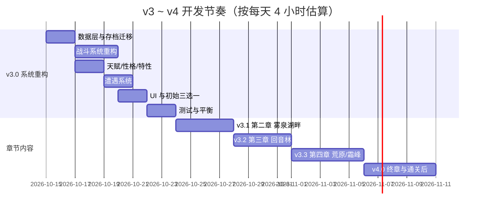
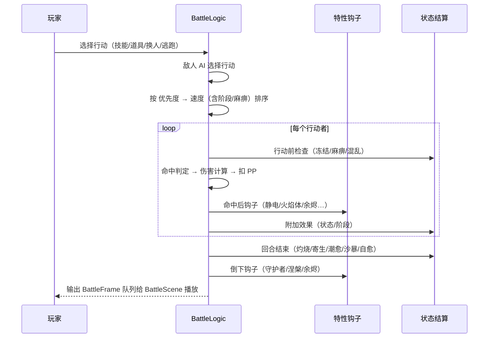

# 07 · 实施路线

**作者：** 周建豪 · **日期：** 2026-10-14 · **状态：** 策划稿

---

## 1. 总原则

- **先系统、后内容**：v3.0 只重构系统并保证第一章完整可玩，新章节在 v3.1 及以后逐章上线
- **每个版本都能通关当前内容**，并且旧存档可以继续玩
- **数据驱动**：伙伴、技能、特性、遭遇表都放在 `src/game/data/`，新增内容不改战斗代码
- **一个功能一个文件**，单文件不超过约 400 行

## 2. 版本拆分

### 2.1 v3.0 · 系统重构（核心版本）

| 模块 | 内容 | 关联文档 |
|------|------|----------|
| 属性 | 4 → 9 属性，完整 9×9 克制表，`tackle` 改为常系 | 02 |
| 伙伴 | 骨架种约 20 只（每属性至少 1 条进化线） | 03 |
| 技能 | 字段扩展（命中/PP/优先度/效果）、5 种状态、能力阶段、约 30 个技能 | 06 |
| 天赋 | 四维资质、D～S 评级、9 种性格、特性（先做 12 个常用的） | 05 |
| 遭遇 | 新遇敌公式、遭遇表、稀有保底、强壮个体、异色 | 04 |
| 开局 | 初始伙伴三选一（焰角兔 / 碧波龟 / 翠叶狐） | 01 |
| UI | 伙伴详情页、技能替换界面、状态图标、评级标识、旅长笔记（克制表） | 05、06 |
| NPC | 记忆婆婆、疗愈师岚的「鉴定」服务 | 05、06 |
| 世界 | 昼夜/天数/满月、天气（晴/雨/雾/沙暴）、旅人告示板、伙伴寄存所、小屋「休息」 | 08 |
| 大事件 | 异象框架 + 流星雨/花海盛放/地火喷涌 3 只唯一精灵；小事件 3 种 | 08 |

### 2.2 v3.1 ～ v4.0 · 章节内容

| 版本 | 地图 | 新属性登场 | 新增伙伴 | 新系统 |
|------|------|------------|----------|--------|
| v3.1 | 雾泉湖畔 | 潮系扩充、霜系预告 | 约 6 只 | 钓鱼、雾天、第一个徽记 |
| v3.2 | 回音林 | 灵系、风系 | 约 6 只 | 亲密度与羁绊技、昼夜 |
| v3.3 | 星砂荒原 / 霜铃峰 | 雷系、霜系 | 约 7 只 | 沙暴、霜雪天气、洞窟 |
| v4.0 | 灰烬之塔 | 传说 | 约 5 只 | 墨尘剧情、终章、通关后秘境、重塑露 |

---

## 3. 代码改造清单

### 3.1 新增文件

| 文件 | 职责 |
|------|------|
| `data/types.ts` | 9 属性定义、克制表、`typeMultiplier()` |
| `data/moves.ts` | 技能表（从 `creatures.ts` 拆出） |
| `data/abilities.ts` | 特性定义与触发时机 |
| `data/natures.ts` | 性格表 |
| `data/encounters.ts` | 各地图遭遇表 |
| `systems/Talent.ts` | 资质掷骰、评级、能力值计算、鉴定 |
| `systems/Encounter.ts` | 遇敌判定、权重抽取、保底、异色 |
| `data/weather.ts` | 天气效果与各地图天气表 |
| `data/phenomena.ts` | 异象与唯一精灵定义 |
| `systems/WorldClock.ts` | 步数、昼夜、天数、满月、天气轮换 |
| `systems/Phenomenon.ts` | 大事件/小事件判定、阶段推进、唯一个体生成 |
| `ui/WeatherLayer.ts` | 天气粒子与昼夜滤镜 |
| `ui/NoticeBoard.ts` | 旅人告示板 |
| `ui/StoragePanel.ts` | 伙伴寄存所 |
| `systems/StatusEffects.ts` | 状态异常与能力阶段的结算 |
| `systems/AbilityHooks.ts` | 特性在战斗各时机的钩子 |
| `ui/CreatureDetail.ts` | 伙伴详情页 |
| `ui/MoveReplacePanel.ts` | 技能替换界面 |
| `scenes/StarterScene.ts` | 初始三选一 |

### 3.2 需要改造的文件

| 文件 | 改动 |
|------|------|
| `data/creatures.ts` | 物种字段扩展（稀有度、特性、学习表），拆分技能 |
| `systems/BattleLogic.ts` | 优先度、命中、PP、状态、阶段、特性钩子、新 AI |
| `systems/Growth.ts` | 技能学习改为交给 UI 选择、亲密度增长、天赋觉醒 |
| `systems/SaveSystem.ts` | v3 存档结构与迁移 |
| `scenes/WorldScene.ts` | 接入 `Encounter.ts` |
| `scenes/BattleScene.ts` | 状态图标、评级标识、PP 显示 |
| `graphics/PixelFactory.ts` | 新体型模板与配色、异色调色板 |

### 3.3 战斗回合流程（重构后）

---

## 4. 存档迁移（v2 → v3）

| v2 字段 | v3 处理 |
|---------|---------|
| `version: 2` | 改为 `3`，保留旧存档备份键 `embertrail-v2-save-backup` |
| 伙伴 `moves: string[]` | 转为 `{ id, pp }[]`，PP 填满 |
| 伙伴无天赋字段 | 补发资质（下限 8）、随机性格、特性取 A、`appraised: false` |
| 伙伴无亲密度 | 按 `等级 × 5` 估算，上限 150 |
| `tackle` 属性 | 数据层直接改常系，存档无需处理 |
| 图鉴 `seen/caught` | 原样保留，新物种默认未见 |
| 新增字段 | `encounterState`（保底计数、步数）、`weatherSeed`、`badges: []`、`starterId` |
| 已有存档的开局 | 视为已选择焰角兔，跳过三选一 |

迁移失败时：保留备份并提示「存档升级失败，可在标题页恢复旧存档」，不直接覆盖。

---

## 5. 数值重调

| 项目 | v2 | v3 | 原因 |
|------|----|----|------|
| 升级经验 | `20 + lv × 10` | `round(12 + lv² × 0.9 + lv × 6)` | 等级上限升到 50，后期曲线需要更陡 |
| 等级成长 | `1 + (lv − 1) × 0.08` | 不变 | 保持第一章手感 |
| 野生战焰币 | `lv × 6` | 不变 | — |
| 收服率 | v2 公式 | 增加状态加成：麻痹/冻结 ×1.5，灼烧 ×1.2 | 让状态技在收服中有用 |
| 进化等级 | 统一 9 | 按物种：初始伙伴 9 / 28；其他物种第一阶段 9～20 | 配合新等级曲线（v3.0 实现值，见 species.ts） |

> 第一章（Lv 3～13）的实际体验必须与 v2 基本一致：用 v2 通关路线回归测试，战斗回合数偏差不超过 ±20%。

---

## 6. 验收标准（v3.0）

| 编号 | 验收项 | 通过标准 |
|------|--------|----------|
| AC-01 | 新开局 | 出现三选一，选择后进入小镇，三只伙伴都能通关第一章 |
| AC-02 | 旧存档 | v2 存档加载后伙伴、道具、焰币、图鉴、进度全部保留，无报错 |
| AC-03 | 克制 | 9×9 表 81 组倍率与 02 文档一致（单元测试） |
| AC-04 | 资质 | 10 万次模拟的评级分布与 05 文档估算偏差 < 3% |
| AC-05 | 状态 | 5 种状态的效果、免疫、解除方式全部生效 |
| AC-06 | 能力阶段 | ±3 封顶，换人清零，倍率与 06 文档一致 |
| AC-07 | PP | 耗尽后不能选择，全部耗尽自动挣扎，回血点回满 |
| AC-08 | 技能替换 | 槽满时出现替换界面，可放弃，放弃有二次确认 |
| AC-09 | 遭遇 | 安全步数、保底、驱兽香/引兽铃生效；1 万步模拟遇敌率与 04 文档一致 |
| AC-10 | 异色 | 强制异色调试开关下，配色、提示、下限 10 生效 |
| AC-11 | 鉴定 | 鉴定前只显示评级，鉴定后显示星级与数值 |
| AC-13 | 昼夜与天气 | 600 步切换昼夜、300 步轮换天气，滤镜/粒子/战斗修正生效；小屋「休息」可跳时段 |
| AC-14 | 异象 | 调试开关强制触发 3 种异象，前兆→小目标→现身→收服完整走通；逃跑后冷却并复用同一个体 |
| AC-15 | 唯一性 | 收服后该异象不再触发；唯一精灵不可放生；队伍满时进入寄存所 |
| AC-12 | 稳定性 | 完整通关第一章无运行时报错，`tsc` 与生产构建通过 |

## 7. 测试计划

- **纯逻辑单元测试**（新增 Vitest，零额外环境）：克制表、伤害公式、状态、阶段、资质分布、遇敌概率、存档迁移
- **浏览器流程测试**：新开局三选一 → 第一章通关；v2 存档升级；异常状态与技能替换交互
- 测试完成后在项目根目录生成 `test_report_YYYYMMDD_HHmm.md`

---

## 8. 风险与对策

| 风险 | 对策 |
|------|------|
| 战斗逻辑复杂度暴涨，难以调试 | 状态、特性、阶段各自独立文件；所有结算产出 `BattleFrame`，可回放 |
| 数值失衡（某属性/特性过强） | 单元测试 + 自动对战模拟（随机 AI 互打 1000 场统计胜率） |
| 像素素材工作量大（44 种） | 13 个体型模板 × 调色板组合；异色只换调色板 |
| 旧存档损坏 | 迁移前备份，失败可恢复 |
| 范围蔓延 | v3.0 严格只做表 2.1 内容，其余进入后续版本 |

---

## 9. 待决策

1. 是否引入 Vitest 做数值单元测试？推荐**引入**（只是开发依赖，玩家无感知）。
2. v3.0 开发顺序是否认可「数据层 → 战斗 → 天赋 → 遭遇 → UI」？
