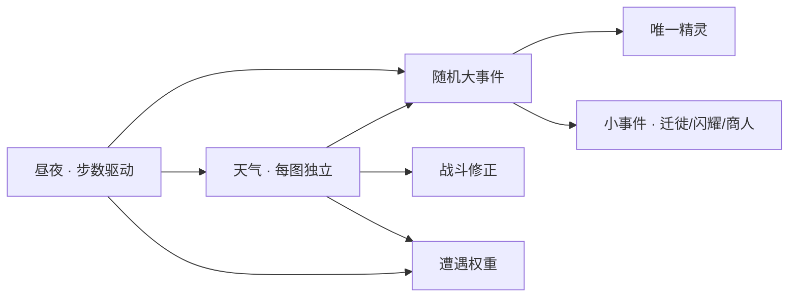
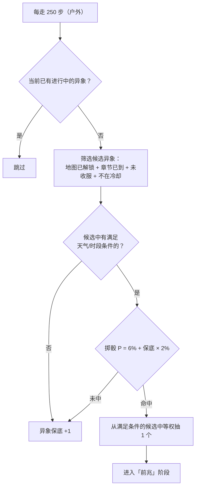
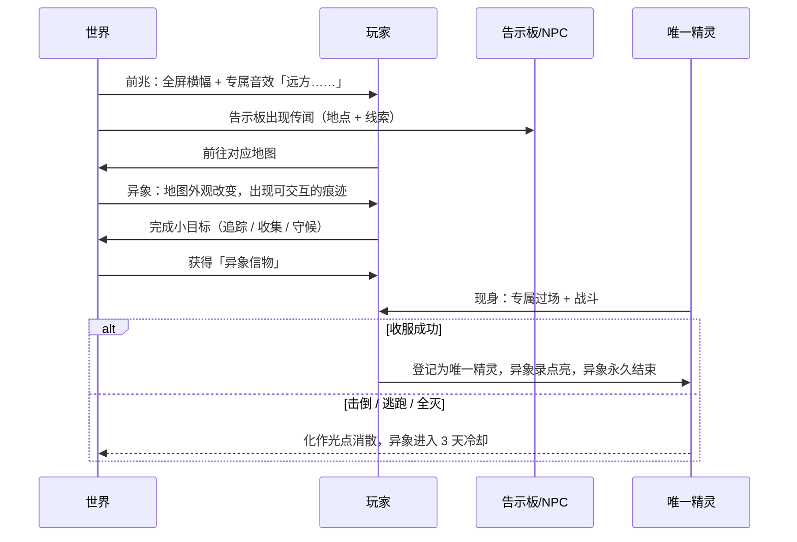

# 08 · 天气、昼夜与随机大事件

**作者：** 周建豪 · **日期：** 2026-10-14 · **状态：** 策划稿（评审已确认：天气、昼夜、异色全部要做；新增随机大事件与唯一精灵）

---

## 1. 设计目标

- **世界是活的**：同一张地图，晴天和雷雨夜看到的伙伴、打出的伤害都不一样
- **每次存档都独一无二**：随机大事件带来「整个存档只有一只」的唯一精灵，成为玩家自己的故事
- **随机但不坑人**：错过大事件不会永久损失；条件与线索都能在游戏里查到



---

## 2. 昼夜

在 04 文档基础上扩展：

| 项目 | 规则 |
|------|------|
| 时段 | 每 **600 步** 昼夜切换；昼 = 第 1～600 步，夜 = 第 601～1200 步，循环 |
| 天数 | 每完成一次昼夜循环 `day + 1`，菜单显示「第 N 天 ☀/☾」 |
| 满月 | 每 **7 天**的夜晚为满月夜，菜单显示 🌕 |
| 黄昏/黎明 | 切换前 60 步为过渡期，画面滤镜渐变（只影响视觉） |
| 夜晚画面 | 深蓝滤镜 25%；路灯、心火灯台发出暖光圈 |
| 夜晚战斗 | 灵系招式 ×1.1 |
| 回血小屋「休息」 | 可选择「睡到天亮 / 等到夜晚」，直接跳到对应时段（免费） |

> 「休息」功能保证玩家永远不用为了等夜晚而反复走路。

---

## 3. 天气

### 3.1 天气种类与效果

| 天气 | 图标 | 战斗效果 | 遭遇效果 | 画面 |
|------|:--:|------|------|------|
| 晴 | ☀ | 焰系 ×1.1，潮系 ×0.9；光合回复 66% | — | 正常 |
| 雨 | 🌧 | 潮系 ×1.1，焰系 ×0.9 | 潮系物种权重 ×1.5 | 雨线粒子 + 轻微变暗 |
| 雾 | 🌫 | 潮系 ×1.1；所有招式命中 −5% | 遇敌率 ×1.1 | 半透明雾层，视野边缘发白 |
| 雷雨 | ⛈ | 雷系 ×1.2，潮系 ×1.1 | 雷系物种权重 ×2 | 雨线 + 随机闪电白屏 |
| 沙暴 | 🏜 | 非岩系每回合损失 1/16 HP | 遇敌率 ×1.3；岩系物种权重 ×1.5 | 黄沙横向粒子 |
| 雪 | ❄ | 冻结几率 ×2 | 霜系物种权重 ×1.5 | 雪花粒子，地面泛白 |
| 心火 | 🔥 | 灵系与焰系 ×1.1（固定，灰烬之塔顶层） | — | 暖橙光晕 |

### 3.2 天气变化规则

- 每张户外地图**各自**拥有天气，每 **300 步**（全局步数）按该地图天气表重掷一次
- 城镇与室内显示所在区域的天气，但不产生战斗/遭遇效果
- 技能「沙暴」只改变当场战斗的天气，战斗结束后恢复地图天气

### 3.3 各地图天气表

| 地图 | 晴 | 雨 | 雾 | 雷雨 | 沙暴 | 雪 |
|------|:--:|:--:|:--:|:--:|:--:|:--:|
| 青苔草地 | 60 | 25 | 15 | — | — | — |
| 余烬山道 | 70 | 10 | — | — | 20 | — |
| 雾泉湖畔 | 25 | 30 | 45 | — | — | — |
| 回音林 | 40 | 30 | 20 | 10 | — | — |
| 星砂荒原 | 40 | — | — | 25 | 35 | — |
| 霜铃峰 | 35 | — | 15 | — | — | 50 |
| 星砂秘境 | 各 1/6 | | | | | |

### 3.4 天气预报

小镇新增 **「旅人告示板」**：
- 显示每张已解锁地图的当前天气与「下次变化还有 N 步」
- 显示大事件**传闻**（见 4.4）
- 显示小事件公告

---

## 4. 随机大事件（异象）

### 4.1 概念

大地上的心火偶尔会剧烈波动，形成**「异象」**：流星雨、地火喷涌、千年雾潮……每种异象都会唤来一只**唯一精灵**。

- 共 **12 种异象 ↔ 12 只唯一精灵**，一一对应
- **每个存档每只唯一精灵只有一只**；收服后，该异象永远不再发生
- 唯一精灵收录于图鉴的独立分区 **「异象录」**，不计入 44 种主图鉴（全收集 = 44 + 12 = 56）

### 4.2 触发规则



| 参数 | 数值 | 说明 |
|------|------|------|
| 判定间隔 | 250 步 | 只在户外地图累计 |
| 基础概率 | 6% | — |
| 保底 | 每次未触发 +2%，触发后清零 | 约 2500 步内必然触发一次 |
| 同时进行 | 最多 1 个 | 避免信息过载 |
| 冷却 | 失败（击倒/逃走）后该异象冷却 3 天 | 不会永久错过 |
| 星砂护符 | 基础概率 +2% | 通关后道具 |

### 4.3 异象生命周期



| 阶段 | 持续 | 玩家看到什么 |
|------|------|------|
| 前兆 | 立即 | 横幅「【异象】夜空中划过数道流星，似乎坠向了青苔草地……」 |
| 异象 | 最多 800 步，或时段条件消失时结束（异象期间所在地图天气锁定，不随 300 步重掷） | 地图变化（陨坑、地火裂缝、雾潮漫过栈道…）+ 痕迹点闪光 |
| 小目标 | — | 三种之一：**追踪**（沿 5 个发光足迹前进）、**收集**（找到 3 块碎片）、**守候**（在指定位置等待到特定时段） |
| 现身 | 一场战斗 | 专属登场演出；对手为唯一精灵，等级 = 队伍最高等级（限 12～50，v3.0 实现值） |

**异象信物：** 完成小目标获得，本场战斗中对该唯一精灵的捕获率 ×2，且唯一精灵**第一回合被信物吸引、不会行动**（v3.0 自测后追加，收服率由约 31～59% 提升到约 43～78%），战后消失。不完成小目标也能直接找到唯一精灵（在异象中心），但没有信物加成。

### 4.4 传闻线索

告示板传闻会**暗示条件**，引导玩家主动去等待异象，而不是纯靠运气：

> 「老人说，满月的夜里，回音林最老的那棵树会说话。」 → 古树低语（回音林 · 满月夜）

---

## 5. 唯一精灵

### 5.1 稀有度档位

在 03 文档稀有度表中新增一档：

| 稀有度 | 标识 | 获取方式 | 种族值总和 | 资质下限 |
|--------|------|----------|-----------|----------|
| **异象** | ✧ | 随机大事件 | 108～118 | 14 |

- 单阶，不进化
- 拥有**专属特性**与**专属技能**（不进入普通特性/技能池）
- 异色判定照常（1/400，受星砂护符影响）——「异色唯一精灵」是全游戏最稀有的收藏
- **个体在异象首次发生时生成并写入存档**；逃走后再次出现仍是同一只（资质、性格、是否异色都不变），防止反复读档刷个体

### 5.2 唯一精灵一览

| # | 异象 | 地图 | 条件 | 开放 | 唯一精灵 | 属性 | HP/攻/防/速 | 总和 |
|:--:|------|------|------|:--:|------|:--:|:--:|:--:|
| U01 | 流星雨 | 青苔草地 | 夜 · 晴 | 第一章后 | 坠星貂 | 常 | 26/28/24/32 | 110 |
| U02 | 花海盛放 | 青苔草地 | 昼 · 晴 | 第一章后 | 花冠鹿 | 叶 | 30/24/28/26 | 108 |
| U03 | 地火喷涌 | 余烬山道 | 昼 | 第一章后 | 熔晶龟 | 焰 | 34/26/36/14 | 110 |
| U04 | 石林苏醒 | 余烬山道 | 沙暴 | 第二章后 | 古岩像 | 岩 | 36/30/38/10 | 114 |
| U05 | 千年雾潮 | 雾泉湖畔 | 雾 | 第二章后 | 雾隐鲤 | 潮 | 28/26/26/32 | 112 |
| U06 | 潮汐倒流 | 雾泉湖畔 | 雨 · 夜 | 第二章后 | 潮歌鲛 | 潮 | 30/30/24/30 | 114 |
| U07 | 百鸟迁徙 | 回音林 | 昼 · 晴 | 第三章后 | 千羽鸮 | 风 | 26/30/22/34 | 112 |
| U08 | 古树低语 | 回音林 | 满月夜 | 第三章后 | 树灵童 | 灵 | 30/24/30/26 | 110 |
| U09 | 雷暴之夜 | 星砂荒原 | 雷雨 · 夜 | 第四章后 | 雷角麟 | 雷 | 28/32/24/34 | 118 |
| U10 | 沙海蜃楼 | 星砂荒原 | 沙暴 · 昼 | 第四章后 | 蜃影狐 | 风 | 26/28/22/36 | 112 |
| U11 | 极光之夜 | 霜铃峰 | 夜 · 晴 | 第四章后 | 极光狐 | 霜 | 28/30/24/34 | 116 |
| U12 | 日蚀 | 任意户外 | 昼，且已收服其余 11 只 | 通关后 | 蚀影 | 灵 | 30/32/28/28 | 118 |

### 5.3 专属特性与专属技能

| 唯一精灵 | 专属特性 | 专属技能 |
|------|------|------|
| 坠星貂 | **许愿**：造成会心后速度 +1 | **坠星** 常 · 40 · 必中 · PP 5 |
| 花冠鹿 | **花香**：每回合结束回复 1/16 HP，30% 解除自身异常 | **千花绽** 叶 · 36 · 回复造成伤害的 25% · PP 10 |
| 熔晶龟 | **熔甲**：受到潮系伤害 ×0.75 | **熔岩潮** 焰 · 42 · 自身速 −1 · PP 5 |
| 古岩像 | **不动**：能力不会被对手降低 | **万钧** 岩 · 45 · 命中 85 · PP 5 |
| 雾隐鲤 | **雾隐**：雾天闪避 +15% | **登龙门** 潮 · 36 · 必中 · 自身速 +1 · PP 10 |
| 潮歌鲛 | **潮歌**：出场时 30% 令对手混乱 | **鲛人之歌** 变化 · 令对手混乱 + 自身速 +1 · PP 10 |
| 千羽鸮 | **群羽**：出场时速度 +1 | **千羽** 风 · 36 · 必中 · PP 10 |
| 树灵童 | **守林**：受到叶系伤害 ×0.5 | **年轮** 变化 · 回复 40% HP + 防 +1 · PP 5 |
| 雷角麟 | **引雷**：受到雷系伤害 ×0.5 并攻 +1 | **天雷** 雷 · 45 · 命中 90 · 20% 麻痹 · PP 5 |
| 蜃影狐 | **幻影**：出场后第一次受到的伤害 ×0.5 | **蜃楼** 变化 · 对手攻 −1、速 −1 · PP 10 |
| 极光狐 | **极光幕**：出场后 3 回合受到伤害 ×0.75 | **极光** 霜 · 40 · 必中 · 10% 冻结 · PP 5 |
| 蚀影 | **蚀日**：出场时将战斗天气变为「蚀」（非灵系招式 ×0.9） | **日蚀之刻** 灵 · 45 · 回复造成伤害的 50% · PP 5 |

### 5.4 异象录（图鉴传说示例）

| 唯一精灵 | 传说 |
|------|------|
| 坠星貂 | 它是流星落地时溅起的那一点光。据说追着它跑一整夜，就能许下一个愿望。 |
| 熔晶龟 | 山腹里的地火每百年喷涌一次，它就趴在火口打个哈欠，再睡一百年。 |
| 潮歌鲛 | 湖水倒流的夜晚，渔人会听见歌声，第二天总有人忘了回家的路。 |
| 树灵童 | 回音林最老的那棵树的孩子，只在满月时下来走走。 |
| 蚀影 | 太阳被吃掉的那一刻，它从所有影子里同时睁开了眼睛。 |

### 5.5 唯一精灵的特殊规则

| 规则 | 内容 |
|------|------|
| 不可放生 | 寄存所中显示「唯一」印记，无法放生 |
| 收服证书 | 伙伴详情页显示「于第 N 天 · 某地图 · 某天气 收服」 |
| 捕获率 | 基础很低（等同守护兽），配合异象信物、状态异常提升 |
| 队伍已满 | 自动送往**伙伴寄存所**（v3.0 新增，见 7 节） |
| 战斗失败 | 把唯一精灵**击倒**：它化作光点消散，异象进入 3 天冷却；**团灭 / 逃跑**：只按普通规则损失焰币，异象与同一只唯一精灵仍在，可回复后再战 |

---

## 6. 小事件（让世界更热闹）

与大事件共用判定框架，但**概率更高、持续更短、不产生唯一精灵**。

| 小事件 | 持续 | 效果 |
|------|------|------|
| 迁徙潮 | 300 步 | 当前地图某一物种权重 ×5 |
| 闪耀时刻 | 200 步 | 异色概率 ×3 |
| 强壮群 | 300 步 | 强壮个体概率 10% → 40% |
| 流浪商人 | 当前昼/夜 | 某地图出现商人，出售资质果、技能书等稀有道具 |
| 训练家集会 | 当前昼/夜 | 已击败的训练家可再次挑战，奖励翻倍 |
| 心火结晶 | 直到拾取 | 地图上出现发光点，拾取获得焰币或道具 |

| 参数 | 数值 |
|------|------|
| 判定间隔 | 150 步（户外） |
| 概率 | 12% |
| 同时进行 | 最多 1 个小事件 + 1 个大事件 |

---

## 7. 关联系统改动

| 系统 | 改动 |
|------|------|
| 遭遇（04） | 遇敌公式中的「天气修正」改为读取本文档 3.1；新增事件修正（迁徙潮、闪耀时刻、强壮群） |
| 属性（02） | 第 6 节「环境」改为动态天气，以本文档 3.1 为准 |
| 图鉴（03） | 新增「异象」稀有度和异象录分区 |
| 伙伴寄存所（新） | 小镇新建筑：存放队伍外的伙伴，支持存入/取出/放生（唯一精灵不可放生） |
| 旅人告示板（新） | 小镇新物件：天气预报 + 异象传闻 + 小事件公告 |
| 回血小屋 | 新增「休息」：跳到天亮或夜晚 |

---

## 8. 数据结构草案

```ts
type Weather = 'sunny' | 'rain' | 'fog' | 'storm' | 'sand' | 'snow' | 'heartfire'

/** 地图天气表 */
interface WeatherTable {
  mapId: string
  weights: Partial<Record<Weather, number>>
}

/** 异象（大事件）定义 */
interface PhenomenonDef {
  id: string                         // 'meteor_shower'
  name: string                       // '流星雨'
  mapId: string
  uniqueSpeciesId: string            // 'u_starfall_marten'
  unlockFlag: string                 // 章节通关 flag
  weather?: Weather[]
  time?: 'day' | 'night' | 'full_moon'
  goal: 'track' | 'collect' | 'wait'
  omenText: string                   // 前兆横幅
  rumorText: string                  // 告示板传闻
}

/** 存档中的世界状态 */
interface WorldClockSave {
  totalSteps: number
  day: number
  weatherByMap: Record<string, Weather>
  nextWeatherRollStep: number
  phenomenon: {
    activeId: string | null
    stage: 'omen' | 'active' | 'goal_done' | null
    stepsLeft: number
    goalProgress: number
    pity: number
    cooldownUntilDay: Record<string, number>
    /** 已生成但尚未收服的唯一个体，逃走后复用 */
    pendingUniques: Record<string, CreatureInstance>
    caught: string[]
  }
  minorEvent: { id: string | null; stepsLeft: number; mapId: string | null }
}
```

---

## 9. 版本分配

| 版本 | 内容 |
|------|------|
| v3.0 | 昼夜 + 天数 + 满月、天气系统（晴/雨/雾/沙暴）、异色、告示板、寄存所、异象框架 + **U01 流星雨 / U02 花海盛放 / U03 地火喷涌**、小事件（迁徙潮、闪耀时刻、心火结晶） |
| v3.1 | U04、U05、U06；小事件「流浪商人」 |
| v3.18 | U04 石林苏醒 / U05 千年雾潮 / U06 潮汐倒流已实现；异象录全收集（SP-5）异色 ×2 |
| v3.19 | U07 百鸟迁徙 / U08 古树低语已实现 |
| v3.20 | U09 雷暴之夜 / U10 沙海蜃楼已实现 |
| v3.21 | U11 极光之夜 / U12 日蚀已实现；规划 12 只唯一精灵齐 |
| v3.22 | 小事件「流浪商人」：当前昼/夜在户外摆摊，卖资质卡与技能书 |
| v3.23 | 小事件「强壮群」「训练家集会」已实现 |
| v3.2 | U07、U08；小事件「训练家集会」「强壮群」 |
| v3.3 | 雷雨、雪天气；U09、U10、U11 |
| v4.0 | U12 日蚀；星砂秘境全天气 |

---

## 10. 待决策

1. 唯一精灵是否允许「异色」？推荐**允许**（终极收藏目标）。
2. 异象战失败后冷却 3 天（约 3600 步）是否合适？可改为 1 天，降低挫败感。
3. 日蚀（U12）要求集齐其余 11 只才触发，是否过于苛刻？备选：通关后即可触发，但只在满月后的白天出现。
