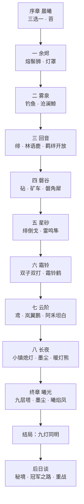

# 焰迹旅人 · 剧本总纲（扩充版）

> 作者：周建豪　｜　日期：2026-10-15　｜　状态：**剧本设计稿 v1（待评审）**
> 取代 `docs/planning/01-世界观与主线剧情.md` 第 3、4 节的章节安排；世界观、角色、主题保持不变。

## 进度

| 文档 | 内容 | 状态 |
|------|------|:--:|
| `00-剧本总纲.md` | 本文：结构、等级曲线、角色弧光、伏笔表、旗标规划 | ✅ |
| `03-第三章-回音.md` | 回音林 · 叶 · 执灯·绯 · 林语鹿 | ✅ |
| `04-第四章-磐谷.md` | 千岩峡谷 / 锤音镇 · 岩 · 掘手·砧 · 磐角犀 | ✅ |
| `05-第五章-星砂.md` | 星砂荒原 · 雷 · 绯再会 · 雷鸣隼 | ✅ |
| `06-第六章-霜铃.md` | 霜铃峰 · 霜 · 双子·朔与望（双打）· 霜铃鹤 | ✅ |
| `07-第七章-云阶.md` | 云阶浮岛 · 风 · 司风·鸢 · 岚翼鹏 · 阿禾坦白 | ✅ 主线 v3.9 |
| `08-第八章-长夜.md` | 晨曦小镇 · 一般 · 小镇的灯被熄灭 · 暖灯熊 | ✅ 主线 v3.10 |
| `09-终章-曦光.md` | 灰烬之塔 · 灵 · 墨尘 · 曦焰凤 | ✅ 主线 v3.11 |
| `10-后日谈与支线.md` | 通关后内容 + 全部支线（30 个） | ✅ 钓鱼大赛 v3.15 |
| `11-伙伴扩充表.md` | 新增伙伴、立绘清单、各章遭遇表 | ✅ |
| 开发 | 按章节逐版实现（v3.4 起每版一章） | ⏳ |

## 1. 为什么要扩充

原规划只有「序章 + 4 章 + 终章」，而游戏已经有 **9 种属性**，五座灯台对不上。扩充后：

- **九座灯台 = 九种属性 = 九章**，每章一座灯台、一只守护兽、一枚徽记，结构清楚，玩家一看就懂「还剩几座」。
- 每章都有**一种新玩法**（谜题 / 交通 / 战斗形式），避免重复。
- 熄灯会从「一个首领 + 几个小兵」扩成**五位干部**，每位都有自己的理由，也都有被感化的可能。

## 2. 九座灯台

| 顺序 | 章节 | 地点 | 灯台属性 | 守护兽 | 干部 / 宿敌 | 新玩法 | 徽记效果 |
|:--:|------|------|:--:|------|------|------|------|
| 序 | 晨曦 | 晨曦小镇 · 青苔草地 | — | — | 巡护员苔 | 收服、对战入门 | — |
| 1 | 余烬 ✓ | 余烬山道 | 焰 | 熔鬃狮 Lv13 | 斥候（灯罩） | 守护兽战 | 焰 ×1.1 |
| 2 | 雾泉 ✓ | 雾泉湖畔 | 潮 | 沧澜鲸 Lv20 | 斥候 ×2 | 钓鱼、连战 | 潮 ×1.1 |
| 3 | 回音 | 回音林 | 叶 | 林语鹿 Lv26 | 执灯·绯 | 回声迷宫、临时组队 | 叶 ×1.1 + 羁绊开放 |
| 4 | 磐谷 | 千岩峡谷 · 锤音镇 | 岩 | 磐角犀 Lv30 | 掘手·砧 | 推石谜题、矿车 | 岩 ×1.1 |
| 5 | 星砂 | 星砂荒原 | 雷 | 雷鸣隼 Lv34 | 执灯·绯（再会） | 沙暴、落雷节奏 | 雷 ×1.1 |
| 6 | 霜铃 | 霜铃峰 | 霜 | 霜铃鹤 Lv38 | 双子·朔与望 | 冰面滑行、双打 | 霜 ×1.1 |
| 7 | 云阶 | 云阶浮岛 | 风 | 岚翼鹏 Lv42 | 司风·鸢 | 风流滑翔、浮岛 | 风 ×1.1 |
| 8 | 长夜 | 晨曦小镇（夜） | 一般 | 暖灯熊 Lv46 | 墨尘（首次正面） | 守镇接力战 | 一般 ×1.1 |
| 终 | 曦光 | 灰烬之塔 | 灵 | 曦焰凤 Lv52 | 墨尘 Lv50 | 九层属性试炼 | — |
| 后 | 后日谈 | 全地图 · 星砂秘境 | — | 守护兽重战 | 冠军之路 | 收集、重战 | — |

## 3. 等级曲线（替换原规划第 4 节）

等级上限 **50 → 60**。每章守护兽比玩家预期等级高 0～2 级。慢速回归（`?regress=slow`）以「玩家预期 Lv」下限为准，带药胜率应 ≥ 60%。

| 章节 | 野生 | 干部 / 训练家 | 守护兽 | 玩家预期 |
|------|:--:|------|:--:|:--:|
| 序章 | 3～6 | 苔 5 | — | 5～8 |
| 1 余烬 | 8～11 | 峰 9 | 13 | 10～13 |
| 2 雾泉 | 13～17 | 斥候 15 | 20（建议改 18，见 v3.3 报告） | 17～20 |
| 3 回音 | 18～23 | 绯 21～23 | 26 | 23～26 |
| 4 磐谷 | 22～27 | 砧 26～28 | 30 | 27～30 |
| 5 星砂 | 26～31 | 绯 30～32 | 34 | 31～34 |
| 6 霜铃 | 30～35 | 朔 / 望 34～36（双打） | 38 | 35～38 |
| 7 云阶 | 34～39 | 鸢 38～40 | 42 | 39～42 |
| 8 长夜 | 38～43 | 墨尘 44～45 | 46 | 43～46 |
| 终 | 42～47 | 墨尘 48～50 | 52 | 48～52 |
| 后日谈 | 45～58 | 冠军之路 55～60 | 重战 55 | 55～60 |

## 4. 角色与弧光

### 4.1 我方

| 角色 | 身份 | 出场章节 | 弧光 |
|------|------|------|------|
| 你 | 焰迹旅人 | 全篇 | 从「被选中」到「自己选择守护」 |
| 旅长阿禾 | 导师 | 序、7、8、终 | 隐瞒 → 第 7 章坦白 → 第 8 章与墨尘对峙 → 终章并肩 |
| 小路 | 小镇孩子 | 每章回镇 | 第 8 章挺身守灯，终章带来全镇的灯 |
| 巡护员苔 | 对手 → 盟友 | 序、3、8 | 第 3 章临时组队；第 8 章带巡护队守镇 |
| 登山客峰 | 对手 → 向导 | 1、4 | 第 4 章矿道向导，讲峡谷传说 |
| 泉守汐 | 雾泉守护 | 2、6 | 第 6 章带雾泉螈群协助渡冰湖 |
| 疗愈师岚 | 后勤 | 全篇 | 鉴定资质；第 8 章开设临时救护站 |
| 钓鱼少年澈 | 支线 | 2、后 | 后日谈「全国钓鱼大赛」 |
| 星图师·穗 | **新** | 5、7 | 荒原观星少女，解读灯台星图；第 7 章造出滑翔翼 |
| 矿镇长·锤婆 | **新** | 4 | 锤音镇镇长，砧的祖母 |

### 4.2 熄灯会

| 角色 | 职位 | 章节 | 动机 | 结局 |
|------|------|------|------|------|
| 墨尘 | 首领 | 7（剪影）、8、终 | 十年前山火，伙伴「灯灯」为救他熄灭 → 认定心火是灾祸 | 救赎，成为灵之灯台守护者 |
| 执灯·绯 | 干部 | 3、5、终 | 山火孤儿，被墨尘收留；害怕「再失去家」 | 第 5 章倒戈，终章并肩 |
| 掘手·砧 | 干部 | 4 | 矿难中失去矿工父亲，认为岩灯台的心火「引来了塌方」 | 第 4 章战后留下修矿道 |
| 双子·朔与望 | 干部 | 5（观战）、6 | 朔想熄火保护望（望天生怕火）；望其实想看极光 | 第 6 章看见心火极光后退出 |
| 司风·鸢 | 干部 | 7 | 曾是阿禾的另一名学徒，知道山火真相 | 第 7 章说出真相后消失，终章送来风之援助 |
| 斥候 ×N | 小兵 | 1～8 | 「首领说的总没错」 | 后日谈成为灯台巡护员 |

### 4.3 墨尘的十年（逐章揭露）

| 揭露度 | 章节 | 揭露内容 | 由谁说出 |
|:--:|------|------|------|
| 10% | 1 | 灯罩是人为的 | 灯台残迹 |
| 20% | 2 | 熄灯会有组织、有首领 | 斥候 |
| 35% | 3 | 首领失去过伙伴 | 绯 |
| 45% | 4 | 首领曾是旅人学徒，「手很稳，会修灯」 | 锤婆 |
| 55% | 5 | 伙伴叫「灯灯」，是一只微光灵 | 绯（倒戈时） |
| 65% | 6 | 墨尘每年冬天来霜铃峰放一盏纸灯 | 望 |
| 80% | 7 | 山火那晚阿禾在场；阿禾为保护村子选择先封山，没赶去救墨尘 | 鸢 → 阿禾坦白 |
| 90% | 8 | 墨尘的墨烬鸦身上有灯灯的火光 | 墨尘本人（动摇） |
| 100% | 终 | 灯灯没有消失，它化成了墨尘身边的墨烬鸦 / 夜幕鸦，一直在守护他 | 曦焰凤 |

## 5. 主线流程

## 6. 伏笔与回收

| 伏笔 | 埋设 | 回收 |
|------|------|------|
| 阿禾家墙上缺了一角的旧合照 | 序章 | 第 7 章：缺的那一角是少年墨尘 |
| 墨尘的墨烬鸦从不攻击伙伴，只打灯罩外的人 | 第 3 章绯战后旁白 | 终章：墨烬鸦是灯灯所化 |
| 湖心灯台底座刻着「给灯灯」 | 第 2 章灯台点亮后可调查 | 第 5 章：墨尘曾偷偷修过雾泉灯台 |
| 锤音镇矿道深处的旧徽章 | 第 4 章 | 第 7 章：阿禾旅团的徽章，墨尘的 |
| 雾灯鳐只在雾天出现 | 第 2 章 | 终章：雾灯鳐群为灰烬之塔照路 |
| 小路一直想做一盏「自己的灯」 | 每章回镇台词 | 第 8 章小路的灯点燃了小镇灯台 |
| 双子的望从不靠近火 | 第 5 章观战 | 第 6 章：望怕火，但想看心火极光 |

## 7. 每章统一结构（开发模板）

每章 = **1 张主地图（必要时 + 1 张城镇 / 室内）+ 5～7 个剧情节拍 + 1 种新玩法 + 1 干部战 + 1 守护兽 + 2～3 个支线 + 3～5 只新伙伴**。

| 环节 | 时长（玩家） | 说明 |
|------|:--:|------|
| 抵达与求助 | 3 分钟 | NPC 交代本章冲突 |
| 探索与练级 | 15 分钟 | 新遭遇表；新伙伴 |
| 新玩法段 | 10 分钟 | 谜题 / 交通 / 特殊战斗 |
| 干部战 | 5 分钟 | 不可逃，输了可重战 |
| 揭露对话 | 2 分钟 | 墨尘往事一块 |
| 守护兽 | 5 分钟 | 战后演出 + 灯台点亮 |
| 章节卡 | 1 分钟 | 徽记 + 下一章解锁 |

## 8. 旗标命名规划

| 章节 | 前缀 | 关键旗标 |
|------|------|------|
| 3 | `forest_` | `forest_unlocked`、`forest_stones_solved`、`kindler_beaten`、`deer_beaten`、`badge_leaf`、`chapter3_done` |
| 4 | `canyon_` | `canyon_unlocked`、`canyon_cart_fixed`、`anvil_beaten`、`rhino_beaten`、`badge_stone`、`chapter4_done` |
| 5 | `dunes_` | `dunes_unlocked`、`dunes_rods_lit`、`kindler_joined`、`falcon_beaten`、`badge_volt`、`chapter5_done` |
| 6 | `frost_` | `frost_unlocked`、`frost_slide_solved`、`twins_beaten`、`crane_beaten`、`badge_frost`、`chapter6_done` |
| 7 | `cloud_` | `cloud_unlocked`、`cloud_glider`、`kite_beaten`、`roc_beaten`、`he_confessed`、`badge_gale`、`chapter7_done` |
| 8 | `night_` | `night_started`、`night_relay_done`、`mochen_met`、`bear_beaten`、`badge_hearth`、`chapter8_done` |
| 终 | `tower_` | `tower_floor_1`～`tower_floor_9`、`mochen_beaten`、`phoenix_trial`、`game_clear` |

## 9. 待决策

1. 九章结构是否认可？（推荐，开发节奏：每版一章）
2. 第 8 章「长夜」把熄灯战打到主角家乡，情绪最重；但游戏风格明亮。处理方式：**小镇的灯被熄灭但没人受伤**，全程有伙伴发光照明，结尾全镇一起点灯。是否接受？
3. 等级上限提到 60，是否接受？
