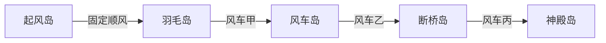

# 第七章 · 云阶（风之灯台）

> 作者：周建豪　｜　日期：2026-10-16　｜　状态：主线已实现 v3.9
> 地点：观星台（穗）→ 霜铃峰风柱 → 云阶五岛 → 风之神殿 → 晨曦小镇（阿禾家）
> 等级：野生 34～39，斥候 36～38，鸢 38～40，岚翼鹏 42
> 新玩法：**滑翔**（岛边顺着风飞到下一座岛）、**三架风车**（顺风才能通过风车岛）
> 章节奖励：风之徽记（风 ×1.1）、星砂滑翔翼（可飞回已经点亮的灯台）
> 本章情绪核心：**阿禾坦白**（揭露 80%）
> 玩法约束：对话选项只用现成的列表菜单，三句回答都通向同一结局，不新做分支树。

## 进度

| 项 | 状态 |
|------|:--:|
| 剧本（节拍、台词、谜题解法、旗标） | ✅ v2 |
| 地图 / 遭遇 / 伙伴 / 立绘 | ✅ 五岛、四种新伙伴（程序绘制） |
| 实现与测试 | ✅ 主线；S7-1～S7-3 支线均已落地（v3.26～v3.28） |

## 1. 本章一句话

穗的星图指向天空。司风·鸢在云上等你——他是阿禾的另一个学徒。朔说过，首领身边有个戴风筝面具的人，什么都知道，却什么都不说。这一章，他把话说完。

## 2. 和前六章怎么接上

| 玩家已经知道的 | 这一章怎么用 |
|------|------|
| 朔的临别警告：戴风筝面具的人 | 神殿岛第一眼就看见面具，鸢自己摘下来 |
| 望说的纸灯、灯灯 | 撕开的照片背面写着「尘 与 灯灯」 |
| 锤婆给的旧徽章（若还在背包） | 鸢多说一句：那是尘的，留在矿道里等他回来拿 |
| 绯已经倒戈 | 神殿台阶上有她的信：她不上来，怕风把灯吹灭 |
| 星图第五、六颗星已亮 | 穗说第七颗不在地上 |

序章墙上那张缺角的合照，游戏里还没摆出来。开发本章时，在晨曦小镇阿禾身边加一块可调查的相框（缺了右下角）。第七章之前调查，只说「缺了一角，背面什么都看不见」。本章把缺的那一角送回来。

## 3. 节拍与台词

### 节拍 1 · 穗的滑翔翼

**解锁：** `chapter6_done` 之后，观星台的穗换台词。对话结束得到星砂滑翔翼，并写上 `cloud_unlocked`。

> 穗：我又算了一遍。第七颗星不在地上。
> 穗：它在云上。霜铃峰的风柱，刚好对着它。
> 穗：所以我做了这个。（一架星砂布和竹骨扎成的小翅膀）
> 穗：站在风柱边上，面朝风，按确认。掉下来会被云接住。……大概。

获得重要物品「星砂滑翔翼」。没有它，风柱只说「风很大，没有翅膀站不稳」。

霜铃峰北侧新增风柱。`cloud_unlocked` 之后，面朝风柱按确认，滑翔到起风岛。滑翔中不扣体力，不遇敌。

### 节拍 2 · 五座岛

岛与岛之间不能走路过去。站在岛边的「风口」上，面朝风按确认，才滑到下一座岛。风若是逆着的，人会被送回上一座岛的入口，并提示「风把你托回来了」。

| 岛 | 风车 | 初始 | 正确 | 这岛上有什么 |
|:--:|------|:--:|:--:|------|
| 起风岛 | 无 | 顺，不能拨 | 顺 | 教学：滑一次到羽毛岛。边缘可云海钓鱼（支线） |
| 羽毛岛 | 甲 | 逆 | 顺 | 穹翼雀的巢。拨一次甲，才能去风车岛 |
| 风车岛 | 乙 | 逆 | 顺 | 岛心还有一条风道，见下一节。拨一次乙，才能去断桥岛 |
| 断桥岛 | 丙 | 逆 | 顺 | 三名斥候。拨一次丙，才能去神殿岛 |
| 神殿岛 | 无 | — | — | 鸢，然后是岚翼鹏 |

三架风车初始都是逆风，各拨一次即为正解。拨错只是被送回来，不惩罚。每座岛入口有木牌，写着当前风向。

旗标：`cloud_mill_a`、`cloud_mill_b`、`cloud_mill_c`（值为「顺」或「逆」）。三架都为顺时写上 `cloud_mills_solved`。神殿岛的风口在此之前锁着，台词是「前头的风还在往回吹」。

**风车岛上的风道（岛内，不另占一座岛）：**

一条直道，三截风。每截跟对应的风车联动：顺风时人站上去会滑到下一截，逆风时滑回道口。

| 截 | 跟哪架风车 | 初始 | 通过条件 |
|:--:|------|:--:|------|
| 1 | 甲（羽毛岛那架，远程也吹到这里） | 逆 | 甲已拨成顺 |
| 2 | 乙 | 逆 | 乙已拨成顺 |
| 3 | 丙还没拨也没关系：这一截跟乙联动，乙为顺就吹向前 | 随乙 | 乙为顺 |

玩家会先被逆风送回，再回去拨风车。木牌写：「三架都顺着神殿，路才通。」不需要记更复杂的密码。

### 节拍 3 · 断桥岛的斥候，和缺掉的那一角

三连战，不可逃。输了从第一名重来。第三名胜利后，地上留下半张照片。

| 顺序 | 名字 | 伙伴 | 等级 |
|:--:|------|------|:--:|
| 1 | 斥候·弦 | 穹翼雀、云团羊 | 36、36 |
| 2 | 斥候·翎 | 旋叶蝠、风铃鸢 | 37、37 |
| 3 | 斥候·筝 | 夜幕鸦、风铃鸢 | 38、38 |

> 筝：这张照片是首领掉的。他说谁捡到谁就拿着，可我们谁也不敢看。

获得重要物品「合照残角」。调查时：

> 一个瘦瘦的少年，肩膀上停着一小团光。
> 背面一行字：「尘 与 灯灯，旅团第三年。」

若背包里有旧徽章，再加一句旁白：徽章上的「尘」，和这行字是同一个字。

旗标：`cloud_photo`、`cloud_scouts_beaten`。

### 节拍 4 · 司风·鸢

神殿门口，戴风筝面具的青年坐在石阶上。台阶上先有一封没有署名的信（绯）：

> 信：我不上来。风太大，灯会灭。
> 信：你问完他，回来告诉我，师父是怎么说的。

> 鸢：朔跟你说过我吧。戴面具的那个。
> 鸢：你好呀，阿禾师父的新徒弟。我叫鸢。
> 鸢：很久以前，我、墨尘，还有你的师父，是同一个旅团的。
> 鸢：你一定听过墨尘的故事了——伙伴为了救他，在山火里熄灭。
> 鸢：你的师父没告诉你后半段。
> 鸢：打赢我，我就说。面具我先摘了。对着面具说话，像在说谎。

**对战：** 司风·鸢，4 只，不可逃。

| 伙伴 | 等级 |
|------|:--:|
| 穹翼雀 | 38 |
| 旋叶蝠 | 38 |
| 风铃鸢 | 39 |
| 夜幕鸦 | 40 |

战后：

> 鸢：山火那晚，火从山顶烧下来。山脚是村子，山腰是墨尘和灯灯。
> 鸢：师父只能选一边。他选了先带村民封山断火。
> 鸢：等他赶到山腰，墨尘抱着一团已经熄灭的光，坐在灰里。
> 鸢：墨尘没有怪师父。他怪的是火。
> 鸢：我知道这一切，却一直没说。因为我也不知道谁是对的。
> 鸢：（把一根白色的风羽放在你手里）去问你师父吧。问完，再决定要不要点亮最后两盏灯。
> 鸢：我先走。终章如果还需要风，我会把风送来。

有旧徽章时，加在「他怪的是火」之后：

> 鸢：你包里那枚旧徽章，是尘的。师父把它留在矿道里，说等他想回来，再自己拿。

鸢离开，不再挡路。旗标：`kite_beaten`。获得重要物品「白风羽」（本章只是信物，终章再用）。

### 节拍 5 · 岚翼鹏

神殿里面，岚翼鹏收着翅膀，周围的风是停的。

守护兽战：岚翼鹏 Lv42，风，不可收服。

- 特性「逆风」：每个回合结束时，若它的速度高于对手，对手速度 −1 阶。它的体力低于一半之后，改为双方速度都 −1 阶。用现有的速度阶级，不另做命中惩罚。
- 招式里带「顺风」（提升自己速度）和「尾风」（风系攻击）。

战后：

1. 它展翅，五座岛之间的风全部变成顺风，滑翔不再被送回。
2. 它低下头。旁白：它在让你坐上来。
3. 一段不操作的飞行：脚下依次亮着余烬、雾泉、回音、磐谷、星砂、霜铃，六座灯和云上这一座，连成一只鸟的形状。
4. 落在晨曦小镇广场。此时还没有章节卡。

旗标：`roc_beaten`、`badge_gale`。获得风之徽记。滑翔翼从此可以快速旅行（见第 5 节）。

### 节拍 6 · 阿禾坦白

广场上，阿禾看着你从鹏背上跳下来，什么都没问，转身走进屋里。屋里的相框还缺着一角。把「合照残角」交给他（调查相框，或直接跟他说话；身上没有残角时，他只说「你先去云上看看」）。

> 阿禾：……鸢都告诉你了。
> 阿禾：是。那天晚上，我选了村子。
> 阿禾：我跑上山的时候，尘——墨尘——没有哭。他只问我：「师父，火是不是很坏？」
> 阿禾：我什么都没回答。我怕我说「不是」，他会恨我；我怕我说「是」，他会恨火。
> 阿禾：结果他只恨了火。他从来没恨过我。所以他才走得那么远。
> 阿禾：（把两半照片对在一起）十年了。我一直在等一个能替我回答的人。
> 阿禾：旅人。你说，火是不是很坏？

弹出三行菜单，选完只改他的下一句，然后都进入同一段收尾：

| 菜单 | 阿禾 |
|------|------|
| 火会伤人，也会温暖人 | 「……是啊。这句话，我本该十年前就告诉他。」 |
| 重要的是谁来守护它 | 「守护。对。灯灯就是这样做的。」 |
| 不说话，看向身边的伙伴 | 他看着你的伙伴，笑了：「你已经回答了。」 |

> 阿禾：剩下两座灯。一座是小镇的初灯，一座在灰烬之塔。
> 阿禾：墨尘一定会回小镇。那是他长大的地方。
> 阿禾：这一次，我不会再什么都不说。

旗标：`he_confessed`、`he_answer`（记下选的是哪一句）、`chapter7_done`。然后才播放章节卡。

> 章节卡：第七章完 · 云阶
> 副标题：新的旅途：初灯（小镇的夜里）

## 4. 回镇与回岛

`chapter7_done` 之后，这些人优先说新台词（要写在旧台词前面，否则旧旗标会先匹配上）。

| 谁 | 台词 |
|------|------|
| 阿禾 | 两半照片我收好了。你若去钟楼，我会跟着。 |
| 小路 | 天上那只大鸟好大！它飞走的时候，我的小灯跟着亮了一下。 |
| 岚 | 从云上下来的人，耳朵里都有风声。坐下，我看看。 |
| 穗 | 第七颗星亮了。星图上还剩两颗：一颗就在小镇，一颗很高、很远。 |
| 雪伯 | 戴面具的人走了？那就好。春天刚回来，经不起再一场山火。 |

滑翔翼的快速旅行，在章节卡之后才开放。菜单里多一行「滑翔」，列出已经点亮的灯台所在的地图：余烬山道、雾泉湖畔、回音林、千岩峡谷、星砂荒原、霜铃峰、云阶起风岛。点一项就落到该图的城镇或入口，不落在首领面前。云阶内部的岛与岛之间，仍然走风口，不进这个菜单。

## 5. 旗标

| 旗标 | 何时写入 |
|------|------|
| `cloud_unlocked` | 穗交出滑翔翼 |
| `cloud_mill_a` / `b` / `c` | 拨风车，值为顺或逆 |
| `cloud_mills_solved` | 三架都是顺 |
| `cloud_scouts_beaten` | 三名斥候都赢了 |
| `cloud_photo` | 拿到合照残角 |
| `kite_beaten` | 赢了鸢 |
| `roc_beaten` | 赢了岚翼鹏 |
| `badge_gale` | 风之徽记 |
| `he_confessed` | 听完阿禾的回答 |
| `he_answer` | `warm` / `guard` / `silent` |
| `chapter7_done` | 与坦白同时，然后出章节卡 |

## 6. 支线（不挡主线）

| # | 名称 | 触发 | 内容 | 奖励 |
|:--:|------|------|------|------|
| S7-1 | 迷路的雏鸟 | 羽毛岛，主线通关前后都能接 | 四只雏鸟分别要送回起风、风车、断桥、神殿。用滑翔把它们带到岛上的巢 | 技能书「顺风」 |
| S7-2 | 云海钓鱼 | 起风岛边缘，需要好钓竿 | 云海里钓到云鳍鱼 | 云鳍鱼 |
| S7-3 | 风羽的信 | `kite_beaten` 之后 | 把鸢留下的五封短信送给苔、峰、汐、锤婆、雪伯。每人回一句，不战斗 | 饰品「白风羽」生效：每场战斗开场，全队速度 +1 阶。信送完之前，风羽只是道具 |

## 7. 遭遇

云阶各岛的草地与风道边：

| 物种 | 稀有 | 权重 | 等级 | 条件 |
|------|:--:|:--:|:--:|------|
| 穹翼雀 | 常见 | 30 | 34～37 | |
| 云团羊 | 常见 | 25 | 34～36 | 晴天 |
| 旋叶蝠 | 常见 | 20 | 34～37 | 夜里 |
| 风铃鸢 | 少见 | 15 | 36～39 | |
| 雷绒獾 | 少见 | 10 | 36～39 | 雷雨 |
| 云鳍鱼 | 稀有 | 只钓鱼 | 37～39 | 好钓竿，起风岛云海 |

新伙伴先用程序像素图：云团羊、风铃鸢、云鳍鱼、岚翼鹏。岚翼鹏不能收服。

## 8. 这一章先不做

- 终章才用的「鸢把风送来」。
- 滑翔翼的自由飞行（不能在空中转向，只能风口对风口，外加菜单里的快速旅行）。
