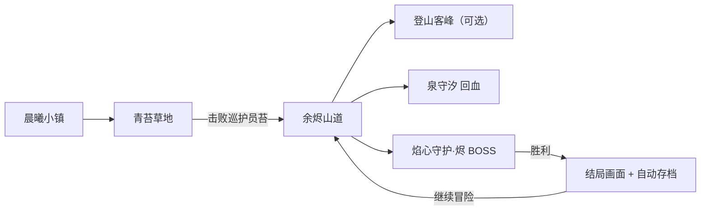
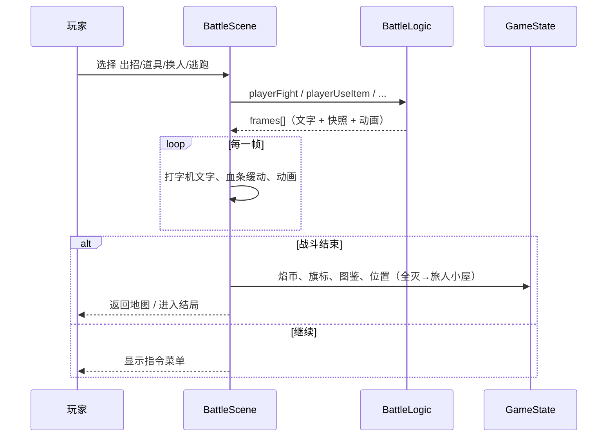

# 焰迹旅人 v2 设计说明

**作者：** 周建豪  
**日期：** 2026-10-14  
**状态：** 已完成开发与自测

## 进度表

| 模块 | 内容 | 状态 |
|------|------|------|
| 成长系统 | 学招表、升级学招（最多 4 招）、9 级进化、经验分享 30% | ✅ |
| 道具与收服 | 背包、5 种道具、安抚果主动收服、杂货铺、焰币 | ✅ |
| 主线内容 | 余烬山道、关卡锁、登山客、温泉守望者、BOSS、结局 | ✅ |
| 打磨 | 打字机对话、血条/经验条动画、受击闪烁与飘字、换人滑入、进化特效、场景过渡、玩家四方向、地图名横幅 | ✅ |
| 图鉴 | 11 种伙伴，遇见/收服记录 | ✅ |
| 存档 | v2 结构，兼容迁移 v1 | ✅ |

## 主线流程

## 战斗时序

逻辑层（`BattleLogic`）只算结果，每条提示生成一帧 `BattleFrame`（含当时双方 HP 快照与动画类型），场景按顺序播放，保证血条与文字同步。

## 关键数值

- 伤害：`((2×Lv/5+2) × 威力 × 攻/防) / 12 × 克制 × 本系1.2 × 会心1.5(1/16) × 浮动0.9~1.1`
- 升级经验：`20 + Lv × 10`
- 收服率：`(1 − HP比 × 0.75) × 0.6 × 道具倍率 + 0.1`，限制在 5%~95%
- 胜利焰币：野生 `等级和×6`，训练家 `×12`，BOSS `×20`

## 存档结构（localStorage `embertrail-v2-save`）

| 字段 | 说明 |
|------|------|
| version | 固定 2 |
| mapId / playerX / playerY | 位置 |
| party | 伙伴数组（含 moves） |
| flags | 剧情旗标：ranger_beaten / hiker_beaten / boss_beaten / game_cleared |
| coins | 焰币 |
| bag | 道具 id → 数量 |
| dex | seen / caught 物种 id 列表 |
| playSeconds / savedAt | 时长与保存时间 |
