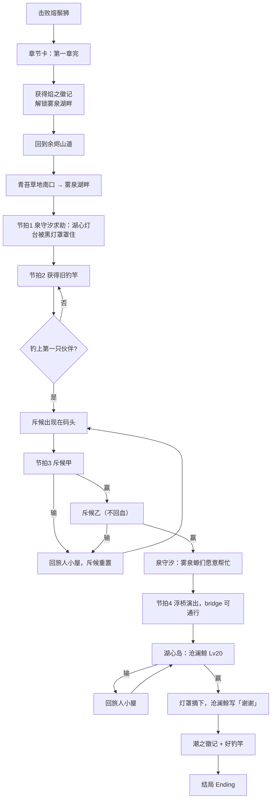
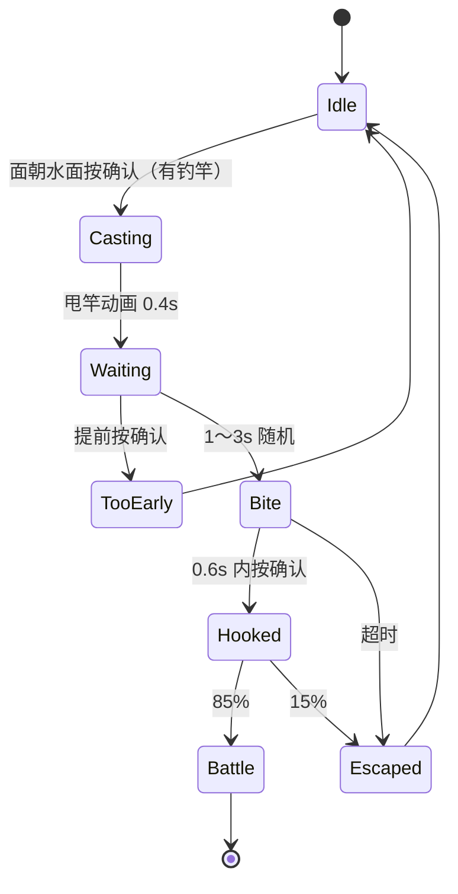
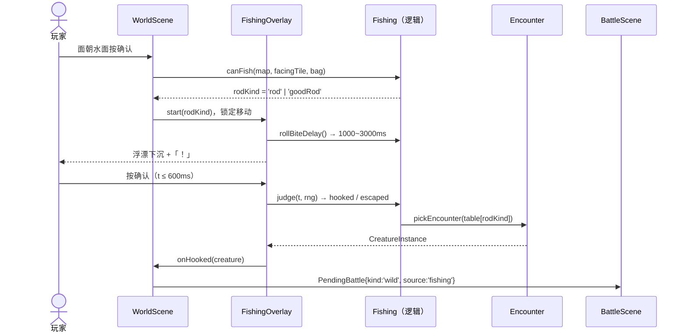
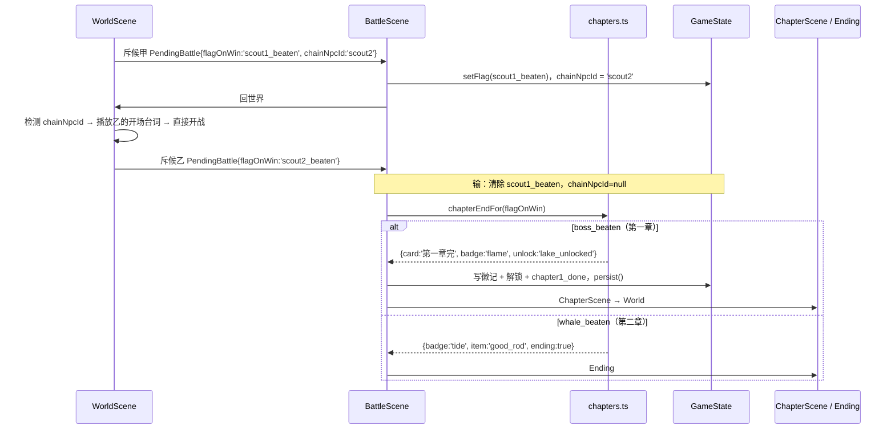

# 焰迹旅人 v3.1 · 第二章「雾泉湖畔」设计文档

> 作者：周建豪　｜　日期：2026-10-15　｜　状态：**核心范围开发完成，自测通过（报告 `test_report_20261015_0912.md`）**
> 依据：`docs/planning/00`（等级曲线）、`01`（主线节拍）、`03`（伙伴数值）、`04`（钓鱼与遭遇表）、`08`（天气表）

## 进度

| 阶段 | 内容 | 状态 |
|------|------|:--:|
| 设计 | 技术方案 / 流程图 / 时序图 / 接口与数据 / 测试用例 | ✅ |
| 开发 1 | 第一章收尾改造（章节卡、焰之徽记、解锁、旧存档迁移） | ✅ |
| 开发 2 | 新伙伴 ×5（数据 + AI 立绘） | ✅ |
| 开发 3 | 雾泉湖畔地图（冰面、浮桥、灯台、新地砖与装饰） | ✅ |
| 开发 4 | 钓鱼小游戏 + 钓竿道具 + 钓鱼遭遇表 | ✅ |
| 开发 5 | 剧情节拍、斥候连战、沧澜鲸、潮之徽记、结局迁移 | ✅ |
| 验证 | tsc / vitest / build / 浏览器逐节拍验证 / 测试报告 / 提交 | ✅ |

---

## 一、范围

**本次做（core）**

1. 第一章收尾改造：击败熔鬃狮后显示「第一章完」，获得 **焰之徽记**，解锁 **雾泉湖畔**，回到世界继续玩；原结局动画挪到第二章末。
2. 新地图 **雾泉湖畔**（户外，天气：晴 25 / 雨 30 / 雾 45），有草丛、冰面、钓鱼水面、浮桥，湖心岛上有灯台。
3. 五个剧情节拍：泉守汐求助 → 获得钓竿 → 熄灯会斥候 ×2 连战 → 雾泉螈浮桥 → 沧澜鲸 Lv20。
4. 钓鱼小游戏：「旧钓竿」和「好钓竿」，各自对应一张遭遇表。
5. 新伙伴 5 种：泡泡鱼 → 珊冠鱼(16)、沧澜鲸（守护兽）、霜粒鹅 → 冰冕鹅(22)，均配 AI 立绘。
6. 徽记加成：持有某属性徽记后，玩家方该属性招式威力 ×1.1。
7. 章节奖励：潮之徽记 + 好钓竿；沧澜鲸战后播放结局。

**本次不做（后续版本）**

- 冰面滑行解谜（本次冰面只是「霜粒鹅专属遭遇格」，不滑行）。
- 沧澜鲸重战 Lv45、回音林（第三章）、U05/U06 异象。
- 斥候、泉守汐的支线对话分支。

---

## 二、技术方案

### 2.1 模块与文件规划

| 文件 | 类型 | 职责 |
|------|:--:|------|
| `src/game/data/maps/mapKit.ts` | 新 | 从 `maps.ts` 拆出的 `TS / fill / setRect / borderWalls / parseAscii`，供各地图文件复用 |
| `src/game/data/maps/lake.ts` | 新 | `buildLake()`：雾泉湖畔地图、NPC、传送点 |
| `src/game/data/maps.ts` | 改 | 引入 mapKit 和 lake；新 TileKind：`ice`、`bridge`；青苔草地南侧新增通往湖畔的传送点（需 `lake_unlocked`） |
| `src/game/data/mapTiles.ts` | 新 | `effectiveTile(map,x,y)`：未搭桥时 `bridge` 视为 `water` |
| `src/game/data/chapters.ts` | 新 | 章节定义：BOSS 旗标 → 章节卡文案、徽记、解锁旗标、是否进结局 |
| `src/game/data/badges.ts` | 新 | 徽记定义（id、名称、属性、图标色）、`badgePowerMod` |
| `src/game/data/species.ts` | 改 | 新增 bubblefin / coralfin / tidewhale / frostgoose / icecrown |
| `src/game/data/encounters.ts` | 改 | 遭遇表新增 `rod`、`goodRod`、`ice` 三个来源；新增 `lake` 表 |
| `src/game/data/items.ts` | 改 | 新 ItemKind `key`（重要物品，不可出售 / 不可在战斗使用）；新增 `old_rod`、`good_rod` |
| `src/game/data/weather.ts` | 改 | `WEATHER_TABLES.lake` |
| `src/game/data/decor.ts` | 改 | 湖畔装饰：灯台（被黑灯罩罩住 / 恢复两态）、码头、芦苇 |
| `src/game/state/GameState.ts` | 改 | `OUTDOOR_MAPS` 加 lake；`PendingBattle` 加 `chainNpcId`；`chainNpcId` 运行时字段；读档迁移 |
| `src/game/state/saveMigrate.ts` | 新 | 旧存档迁移：已击败熔鬃狮 → 补发焰之徽记 + 解锁湖畔 |
| `src/game/systems/Fishing.ts` | 新 | 纯逻辑：钓鱼状态机、判定窗口、成功率、抽取遭遇（可单测） |
| `src/game/ui/FishingOverlay.ts` | 新 | 钓鱼表现：浮漂、「！」气泡、提示文字，接收按键 |
| `src/game/ui/ChapterCard.ts` | 新 | 「第一章完」章节卡（全屏渐显 + 徽记图标），也作为独立 Scene `ChapterScene` |
| `src/game/scenes/WorldScene.ts` | 改（少量） | 确认键 → 面朝水面时交给 FishingOverlay；进场时检查 `chainNpcId` 自动开下一场；剧情 NPC 触发 |
| `src/game/scenes/world/StoryEvents.ts` | 新 | 湖畔剧情节拍处理（给钓竿、搭浮桥、灯台演出），保持 WorldScene 不再膨胀 |
| `src/game/scenes/BattleScene.ts` | 改（少量） | `finish()` 改用 `chapters.ts` 决定去向；连战设置 `chainNpcId` |
| `src/game/systems/BattleCalc.ts` | 改 | 伤害公式乘 `badgePowerMod` |
| `src/game/systems/BattleCore.ts` | 改 | `BattleState.badges: CreatureType[]` |
| `src/game/graphics/tiles/*` | 改 | 程序化绘制 `tile-ice`、`tile-bridge`、湖畔草地变体 |
| `src/game/graphics/CharArt.ts` | 改 | 新 NPC 立绘表 `char-npcs2`（熄灯会斥候 ×2） |
| `art-src/creatures/*.jpg`、`art-src/decor/*.jpg`、`art-src/chars/npcs2.jpg` | 新 | AI 原图 |

> 约束：单文件 ≤ ~400 行；WorldScene / BattleScene 只加「调用一行」级别的改动，逻辑进新文件。

### 2.2 剧情旗标

| 旗标 | 写入时机 | 作用 |
|------|----------|------|
| `boss_beaten` | 击败熔鬃狮（已有） | 异象、告示板（保持不变） |
| `chapter1_done` | 第一章章节卡播完 | 防止重复播放章节卡 |
| `badge_flame` | 同上 | 焰属性招式 ×1.1 |
| `lake_unlocked` | 同上 | 青苔草地 → 雾泉湖畔传送点放行；`OUTDOOR_MAPS` 解锁 |
| `lake_met_shio` | 首次与湖畔泉守汐对话 | 节拍 1 |
| （道具）`old_rod` | 节拍 1 对话结束时获得 | 节拍 2：可钓鱼 |
| `lake_first_fish` | 第一次钓上伙伴（战斗结束） | 泉守汐台词推进，斥候出现在码头 |
| `scout1_beaten` / `scout2_beaten` | 斥候连战胜利 | 节拍 3 |
| `bridge_open` | 斥候连战后与泉守汐对话 | 节拍 4：`bridge` 格可通行，播放雾泉螈搭桥演出 |
| `whale_beaten` | 击败沧澜鲸 | 节拍 5 |
| `badge_tide` | 沧澜鲸战后 | 潮属性招式 ×1.1；同时获得 `good_rod` |

### 2.3 地图：雾泉湖畔（20 × 15，草稿）

```
####################
#~~~~~~~LLL~~~~~~~~#   L = 湖心岛（灯台装饰 + 沧澜鲸，站在 (9,2) 前方水面）
#~~~~~~,,,,,~~~~~~~#
#~~~~~~,,.,,~~~~~~~#
#~~~~~~~~=~~~~~~~~~#   = = bridge（未搭桥时渲染为水面、不可走）
#~~~~~~~~=~~~~~~~~~#
#~~**~~~~=~~~~~~~~~#   * = ice 冰面（霜粒鹅）
#~***~~..=..~~""""~#
#~~**~...........""#   " = 草丛（云雀羽 / 雾泉螈 / 碧波龟）
#~~~~...._...."""""#   _ = 码头（装饰，斥候站这里）
#""""............""#
#"""".....S......."#   S = 泉守汐
#"".............."""#
#........WW........#   WW = 回青苔草地
####################
```

最终坐标以实现为准；规则：岸边任意面朝 `water` 的格子都可钓鱼，`bridge` 未开放时也算水面。

### 2.4 钓鱼规则（来自 04 号策划）

- 条件：背包有 `old_rod` 或 `good_rod`；面朝 `water`（或未开放的 `bridge`）；当前地图遭遇表有 `rod` 来源。
- 流程：甩竿 → 随机 1～3 秒后浮漂下沉并出现「！」 → **0.6 秒内**按确认 → 85% 上钩进战斗，15% 「鱼溜走了」。
- 太早按：「还没咬钩……」，收竿；超时未按：「鱼溜走了」。均可立即重试，无惩罚、不消耗道具。
- 持有好钓竿时自动用好钓竿表；钓鱼不受驱散铃影响，受诱饵影响（稀有权重 ×1.5，复用现有 `lureActive`）。
- 钓鱼不推进步数、不触发异象。

### 2.5 遭遇表（雾泉湖畔，Lv 13～17）

| 来源 | 物种 | 权重 | 等级 |
|------|------|:--:|:--:|
| 草丛 grass | 云雀羽 skylark | 30 | 13～15 |
| 草丛 grass | 雾泉螈 mistnewt | 20 | 13～16 |
| 草丛 grass | 碧波龟 tideback | 15 | 14～16 |
| 冰面 ice（每步 10%） | 霜粒鹅 frostgoose | 100 | 14～17 |
| 旧钓竿 rod | 泡泡鱼 bubblefin | 80 | 12～15 |
| 旧钓竿 rod | 雾泉螈 mistnewt | 20 | 13～15 |
| 好钓竿 goodRod | 珊冠鱼 coralfin | 60 | 16～18 |
| 好钓竿 goodRod | 澜鳍螈 wavefin | 30 | 17～19 |
| 好钓竿 goodRod | 碧波龟 tideback（稀有） | 10 | 18～20 |

### 2.6 新伙伴

| id | 名称 | 属性 | 稀 | HP/攻/防/速 | 进化 | 风格（美术） |
|----|------|:--:|:--:|------|------|------|
| bubblefin | 泡泡鱼 | 潮 | ● | 28/11/11/14 | → coralfin Lv16 | 圆滚滚、吐泡泡，**可爱** |
| coralfin | 珊冠鱼 | 潮 | ● | 38/16/15/19 | — | 头顶珊瑚冠，优雅 |
| tidewhale | 沧澜鲸 | 潮 | ♛ | 62/18/18/10 | 单阶 | 庄严、温柔的巨鲸，**霸气** |
| frostgoose | 霜粒鹅 | 霜 | ◆ | 34/14/13/11 | → icecrown Lv22 | 毛茸茸小鹅，可爱 |
| icecrown | 冰冕鹅 | 霜 | ◆ | 46/19/18/14 | — | 冰晶冠羽，帅气 |

招式全部复用现有招式（潮：splash / bubble_roll / aqua_ring / tide_crash / torrent / abyss_roar；霜：ice_shard / frost_breath / cold_mist / frost_wall / icicle / blizzard）。
美术遵循 `docs/art-guide.md`：明亮、正面，16-bit 像素，1px 描边，洋红底，用 `process-sprites.py` 处理。

### 2.7 战斗配置

| 战斗 | 队伍 | 规则 |
|------|------|------|
| 熄灯会·斥候 甲 | cindermoth Lv14、mistnewt Lv15 | 胜利后**不回世界**，直接开乙战 |
| 熄灯会·斥候 乙 | rockmite Lv15、skylark Lv15 | 中间不回血；任意一场输 = 两场都要重打 |
| 沧澜鲸（守护兽） | tidewhale Lv20 | `kind: 'boss'`；可逃跑 = 否；胜利后播结局 |

> 墨烬鸦 inkcrow 属于后续版本，斥候本次用现有物种组队。

### 2.8 徽记加成

`calcDamage` 增加一项：`badgePowerMod(s, attacker, move)` —— 攻击方在玩家队伍里，并且 `s.badges` 包含 `move.type`，返回 1.1，否则返回 1。敌方不享受加成。

---

## 三、流程图

### 3.1 第二章主线



### 3.2 钓鱼状态机



---

## 四、时序图

### 4.1 钓鱼



### 4.2 斥候连战与章节结束



---

## 五、接口与数据设计

> 本项目没有后端和数据库，存档写在浏览器 localStorage。下面是模块间的 TypeScript 接口。

### 5.1 遭遇表

```ts
export interface EncounterTable {
  baseRate: number
  grass: EncounterEntry[]
  /** 冰面：每步固定 10% */
  ice?: EncounterEntry[]
  /** 旧钓竿 */
  rod?: EncounterEntry[]
  /** 好钓竿 */
  goodRod?: EncounterEntry[]
}
```

### 5.2 钓鱼逻辑（`systems/Fishing.ts`）

```ts
export type RodKind = 'rod' | 'goodRod'
export const FISHING = { biteMinMs: 1000, biteMaxMs: 3000, windowMs: 600, hookChance: 0.85 }
export function rodKindOf(bag: Record<string, number>): RodKind | null
export function canFish(map: MapDef, x: number, y: number, hasFlag: (k: string) => boolean): boolean
export function rollBiteDelay(rng?: Rng): number
export function judgeReel(elapsedSinceBiteMs: number, rng?: Rng): 'hooked' | 'escaped' | 'early'
export function pickFishing(mapId: string, rod: RodKind, ctx: EncounterCtx): CreatureInstance | undefined
```

### 5.3 章节（`data/chapters.ts`）

```ts
export interface ChapterEnd {
  bossFlag: string             // 'boss_beaten' | 'whale_beaten'
  card?: { title: string; subtitle: string }
  badge: BadgeId               // 'flame' | 'tide'
  unlockFlags: string[]        // ['chapter1_done','lake_unlocked']
  items?: string[]             // ['good_rod']
  ending: boolean
}
export function chapterEndFor(flag: string | undefined): ChapterEnd | null
```

### 5.4 徽记（`data/badges.ts`）

```ts
export type BadgeId = 'flame' | 'tide'
export interface BadgeDef { id: BadgeId; name: string; type: CreatureType; flag: string; color: number }
export const BADGES: Record<BadgeId, BadgeDef>
export function ownedBadgeTypes(hasFlag: (k: string) => boolean): CreatureType[]
export function badgePowerMod(s: BattleState, attacker: CreatureInstance, move: MoveDef): number
```

### 5.5 PendingBattle 扩展

```ts
interface PendingBattle {
  // …原有字段
  /** 胜利后立即在世界中开启的下一场训练家战（连战） */
  chainNpcId?: string
  /** 连战失败时需要回滚的旗标 */
  chainResetFlags?: string[]
  /** 遭遇来源，用于战后文案与统计 */
  source?: 'grass' | 'ice' | 'fishing' | 'npc' | 'phenomenon'
}
```

### 5.6 存档字段（localStorage）

| 字段 | 类型 | 说明 | 旧存档默认 |
|------|------|------|------|
| `flags.chapter1_done` 等 | boolean | 见 2.2 | 迁移补齐 |
| `bag.old_rod` / `bag.good_rod` | number | 重要物品，数量固定为 1 | 0 |
| `world.weatherByMap.lake` | Weather | 新地图天气 | 首次进入时生成 |
| `chainNpcId` | — | **不存档**（运行时），刷新页面则连战重置 | — |

迁移规则（`saveMigrate.ts`，读档时执行，可重复执行）：
1. `boss_beaten && !chapter1_done` → 写入 `chapter1_done`、`badge_flame`、`lake_unlocked`（不播放章节卡，进入世界时提示一次「获得焰之徽记，雾泉湖畔已解锁」）。
2. `whale_beaten && !badge_tide` → 补 `badge_tide` 与 `good_rod`。

### 5.7 「表设计」说明

本项目没有数据库，对应的「表」是 TS 静态数据表：`SPECIES`、`ENCOUNTERS`、`ITEMS`、`MAPS`、`DECOR`、`WEATHER_TABLES`、`BADGES`、`CHAPTERS`。新增行已在 2.5～2.8 节列出。

---

## 六、美术清单（AI 生成 → `art-src/` → 脚本处理）

| 资源 | 数量 | 处理脚本 | 输出 |
|------|:--:|------|------|
| 伙伴立绘（5 种） | 5 | `scripts/process-sprites.py` | `public/assets/creatures/*.png` |
| 斥候 NPC（4 方向不需要，单帧 + 呼吸） | 1 张 2 帧 | `scripts/process-chars.py` | `char-npcs2.png` |
| 灯台（罩着 / 亮起 两态）、码头、芦苇丛 | 1～2 张 | `scripts/process-decor.py` | `public/assets/decor/decor-*.png` |
| 湖畔背景（战斗背景） | 1 | 同现有背景流程 | `bg-lake` |
| 冰面、浮桥地砖 | 程序化 | `PixelPen` | `tile-ice`、`tile-bridge` |

斥候设计基调：「神秘但不邪恶」——深蓝斗篷 + 提着熄灭的灯，表情是迷茫而非凶恶，与全游戏明亮正面的风格保持一致。

---

## 七、风险与注意

1. **WorldScene / BattleScene 已超长**：本次逻辑一律放新文件，两大场景只加入口调用。
2. **连战回滚**：任一场失败必须清掉 `scout1_beaten`，否则会出现只剩乙的情况。
3. **桥格碰撞**：碰撞、渲染、钓鱼判定都必须通过 `effectiveTile()` 读取，避免各处判断不一致。
4. **旧存档**：已通关第一章的玩家读档后不会看到章节卡，改为一次性提示，避免卡住。
5. **结局迁移**：`isBoss` 不再直接跳 Ending，统一走 `chapterEndFor()`；需要回归第一章 BOSS 战。
