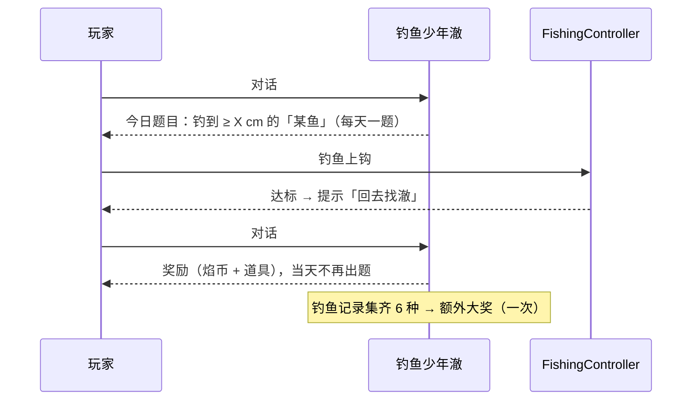

# 焰迹旅人 v3.2 · 湖畔打磨与钓鱼玩法 设计文档

> 作者：周建豪　｜　日期：2026-10-15　｜　状态：**开发完成，自测通过（报告 `test_report_20261015_0927.md`）**
> 依据：`test_report_20261015_0912.md` 第四、五节遗留问题与建议；`docs/v3.1-chapter2-design.md`

## 进度

| 阶段 | 内容 | 状态 |
|------|------|:--:|
| 设计 | 本文档 + 测试用例（第 7 节） | ✅ |
| 开发 1 | 体验修复：鲸跃出水面、鲸位置避开 HUD、结局后灯台点亮演出（演出期间隐藏 HUD） | ✅ |
| 开发 2 | 拆分 WorldScene（NPC 层 / 交互 / 钓鱼）与 BattleScene（战后结算） | ✅ |
| 开发 3 | 一键剧情回归（`?regress=1`） | ✅ |
| 开发 4 | 冰冕鹅野外来源、雾天稀有鱼「雾灯鳐」、钓鱼图鉴、钓鱼大赛支线 | ✅ |
| 验证 | tsc / vitest / build / 浏览器 / 测试报告 / 提交 | ✅ |

## 1. 体验修复

| 问题 | 方案 |
|------|------|
| 搭桥演出时看不到沧澜鲸 | 雾泉螈搭完桥后接一段「鲸跃」：沧澜鲸从湖心水下跃起（弧线 + 水花圈 + 镜头轻震），落回原位后再刷新地图 |
| 沧澜鲸被顶部 HUD 遮住 | 湖心岛整体下移一行：第 1～2 行为水面，鲸在 (10,2)；湖心岛第 3～4 行，灯台 (11,3)；浮桥变为第 5～6 行 |
| 打赢后看不到灯台点亮 | 新旗标 `lighthouse_lit_seen`。从结局「继续冒险」回到湖畔时，若已击败鲸且未看过演出：先按「熄灭」状态铺装饰，再播放灯台点亮（光柱 + 光环 + 闪白），结束后写旗标并刷新 |

## 2. 代码拆分

| 新文件 | 来源 | 职责 |
|------|------|------|
| `scenes/world/WorldHost.ts` | 新 | WorldScene 暴露给子模块的能力接口（对话、提示、开战、忙碌锁、位置等） |
| `scenes/world/NpcLayer.ts` | WorldScene.spawnNpcs | 生成 NPC / 守护兽 / 告示板与头顶标记，返回守护兽精灵以便演出使用 |
| `scenes/world/NpcInteract.ts` | WorldScene.tryInteract 等 | NPC 互动分发、训练家 / 连战 / 守护兽开战、唯一精灵现身 |
| `scenes/world/FishingController.ts` | WorldScene.tryFish + 钓鱼输入 | 甩竿条件、钓鱼输入、上钩结果、钓鱼图鉴登记、大赛达标提示 |
| `scenes/world/LakeCutscenes.ts` | WorldFx | 鲸跃、灯台点亮 |
| `scenes/battle/BattleSettle.ts` | BattleScene.finish / settlePhenomenon | 战后写回（金币、旗标、图鉴、寄存所、异象、章节去向） |

## 3. 一键剧情回归

- 开发服务器运行时打开 `http://127.0.0.1:45321/?regress=1`，或双击 `scripts\run-regress.bat`。
- `src/dev/storyRegression.ts`（仅开发模式加载）：**先备份本地存档，结束后还原**，按节拍驱动真实场景：


- 每步记录 通过 / 失败 / 耗时 / 说明，页面右上角显示结果面板，同时写入 `window.__regressResult` 与控制台表格。

## 4. 新内容

### 4.1 冰冕鹅野外来源

湖畔冰面在 **击败沧澜鲸后的夜晚** 有小概率遇到冰冕鹅（Lv.22～24，权重 8，霜粒鹅 100）。遭遇条目新增 `requireFlag`。

### 4.2 雾天稀有鱼「雾灯鳐」（No.38，灵系，稀有）

| 钓竿 | 条件 | 权重 | 等级 |
|------|------|:--:|:--:|
| 旧钓竿 | 湖畔起雾 | 6 | 16～18 |
| 好钓竿 | 湖畔起雾 | 12 | 18～21 |

遭遇条目新增 `weather?: Weather[]`（只在这些天气出现）。稀有种计入稀有保底。

### 4.3 钓鱼图鉴

- 存于 `world.fishLog`：`{ [speciesId]: { count, best } }`（旧存档缺省为空）。
- 每次上钩随机体长：`物种基准 × (0.75 ~ 1.30)`，强壮个体 ×1.15，保留 1 位小数（cm）。
- 菜单新增「钓鱼记录」：列出湖畔可钓的 6 种（泡泡鱼、雾泉螈、珊冠鱼、澜鳍螈、碧波龟、雾灯鳐），未钓到显示 ？？？；显示次数与最大体长。

### 4.4 钓鱼大赛支线（钓鱼少年澈）



- 题目：按天数在「当前钓竿能钓到的非稀有鱼」中轮换，目标体长 = 基准 × 1.10。
- 每日奖励：200 焰币 + 轮换道具（好伤药 / 蜜安抚果 / PP 果）。
- 集齐大奖：500 焰币 + 引兽铃 ×3，旗标 `fish_master`。
- 状态存于 `world.fishContest`：`{ day, speciesId, minSize, done, claimed }`。

## 5. 数据与接口

```ts
interface EncounterEntry { /* … */ weather?: Weather[]; requireFlag?: string }
interface EncounterContext { /* … */ hasFlag?: (k: string) => boolean }
interface FishRecord { count: number; best: number }
interface FishContest { day: number; speciesId: string; minSize: number; done: boolean; claimed: boolean }
interface WorldSave { /* … */ fishLog?: Record<string, FishRecord>; fishContest?: FishContest | null }
```

## 6. 风险

- 湖心岛下移会改变浮桥格数（3 → 2），需同步单测 U-21/U-22 与演出（已确认 U-22 用的 (10,5) 仍是桥格）。
- 回归脚本会改写运行时状态，必须备份 / 还原 `localStorage` 存档。

## 7. 测试用例

| 编号 | 用例 | 预期 |
|------|------|------|
| T-01 | 搭桥演出 | 雾泉螈搭桥后沧澜鲸跃出水面，演出后鲸停在 (10,2)，不被 HUD 遮挡 |
| T-02 | 结局 → 继续冒险 | 回到湖畔播放灯台点亮，写入 `lighthouse_lit_seen`；再次进入湖畔不再播放 |
| T-03 | 冰面夜晚（已击败鲸） | 可遇到冰冕鹅 Lv.22～24；未击败鲸或白天不出现 |
| T-04 | 雾天钓鱼 | 只有雾天能钓到雾灯鳐；晴 / 雨天不会出现 |
| T-05 | 钓鱼图鉴 | 上钩后登记次数与最大体长；菜单「钓鱼记录」正确显示 |
| T-06 | 钓鱼大赛 | 接题 → 钓到达标的鱼提示 → 回报领奖；当天再次对话不重复发奖 |
| T-07 | 集齐大奖 | 6 种齐全后对话获得大奖一次 |
| T-08 | 一键回归 | `?regress=1` 全部步骤通过；结束后原存档保持不变 |
| T-09 | 回归旧功能 | 第一章章节卡、斥候连战回滚、旧单测全部通过 |
