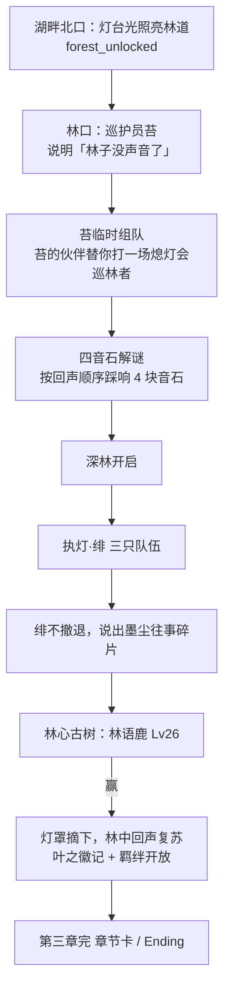

# 焰迹旅人 v3.4 · 第三章「回音林」设计稿

> 作者：周建豪　｜　日期：2026-10-15　｜　状态：**设计稿，待确认范围后开发**
> 依据：`docs/planning/01-世界观与主线剧情.md` 第三章、`03-伙伴图鉴.md`、`04-遭遇系统.md` 回音林表、`06-技能系统.md` 羁绊技
> 说明：之前的建议里说熄灯会首领在「雪山」出场，与规划不符。规划中第三章是**回音林**，首领墨尘到终章才正面登场，第三章由干部**执灯·绯**出战。本稿以规划为准。

## 进度

| 阶段 | 内容 | 状态 |
|------|------|:--:|
| 设计 | 本稿 + 测试用例（第 8 节） | ✅ 待确认 |
| 开发 1 | 回音林地图（迷宫型，回声误导）+ 遭遇表 + 天气 | ⏳ |
| 开发 2 | 新伙伴与立绘（林语鹿、旋叶蝠、微光灵 → 萤灯灵） | ⏳ |
| 开发 3 | 剧情：苔临时组队 → 四音石解谜 → 执灯·绯 → 林语鹿 → 结局 | ⏳ |
| 开发 4 | 叶之徽记 + 羁绊系统开放（亲密度可视化、三阶段剧情） | ⏳ |
| 验证 | 单测、快慢两种回归加入第三章、浏览器、报告、提交 | ⏳ |

## 1. 章节概要

| 项 | 内容 |
|------|------|
| 地点 | 回音林（从雾泉湖畔北侧进入；击败沧澜鲸后解锁，旗标 `forest_unlocked`） |
| 核心冲突 | 林中伙伴集体失去声音：林心古树上的灯台被黑色灯罩罩住，回声被「吞掉」 |
| 等级带 | 野生 Lv18～23；执灯·绯三只 Lv19～21；林语鹿 Lv26（守护兽，叶） |
| 奖励 | 叶之徽记（叶系招式 ×1.1）、羁绊系统正式开放 |
| 反派揭露 | 30%：绯说出墨尘「十年前失去过伙伴」 |

## 2. 剧情节拍

| # | 节拍 | 关键机制 | 旗标 |
|:--:|------|------|------|
| 1 | 苔在林口登场 | 对话；提示迷路时「跟着光走」 | `forest_met_moss` |
| 2 | 临时组队 | **苔的伙伴（叶系 Lv20）上场替你战斗一场**，打完后回到你的队伍 | `forest_team_battle` |
| 3 | 四音石 | 林中 4 块音石：靠近时播放音调（AudioBeeps），需按「回声顺序」踩响；踩错全部熄灭重来 | `forest_stones_solved` |
| 4 | 执灯·绯 | 三只队伍训练家战，不可逃；输了回小屋，可重战 | `kindler_beaten` |
| 5 | 绯的往事 | 战后 4～5 句对话：她是被墨尘收留的孤儿，墨尘「每晚都对着一盏熄灭的灯说话」 | `kindler_story` |
| 6 | 林语鹿 | 守护兽战（复用 `boss` 流程与守护兽地图放大） | `deer_beaten` |
| 7 | 章节奖励 | 叶之徽记、羁绊开放；第三章完章节卡 | `badge_leaf`、`chapter3_done` |

## 3. 地图「回音林」

- 尺寸沿用 20×15（640×480），草地 + 树墙迷宫，林心古树在北侧中央。
- **回声误导**：迷宫中有 3 处「回声岔口」，告示提示「左边传来脚步声……」，实际正确方向相反（只是文字提示，不做强制传送，避免挫败）。
- 四音石位于迷宫 4 个角落；萤光菇装饰作为夜间路灯（复用 decor 机制）。
- 天气表（规划）：晴 40 / 雨 30 / 雾 20 / 雷雨 10。

## 4. 遭遇表（Lv18～23）

| 物种 | 现状 | 稀 | 权重 | 等级 | 时段 |
|------|------|:--:|:--:|:--:|:--:|
| 蓬尾鼠 bushtail | 已有 | ● | 30 | 18～21 | |
| 芽芽菇 sproutcap | 已有 | ● | 30 | 18～20 | |
| 伞灵菇 parashroom | 已有 | ◆ | 15 | 21～23 | |
| 翠叶狐 leafkit | 已有 | ◆ | 12 | 18～21 | |
| 旋叶蝠 whirlbat | **新** | ◆ | 20 | 19～22 | 夜 |
| 微光灵 wisp | **新** | ★ | 4 | 20～22 | 夜 |

## 5. 新伙伴（需 AI 生成立绘，16-bit 像素、明亮可爱、品红底）

| 编号 | 名称 | id | 属性 | 稀 | 种族值 HP/攻/防/速 | 进化 | 形象 |
|:--:|------|------|:--:|:--:|------|------|------|
| 25 | 林语鹿 | echodeer | 叶 | ♛ | 56/19/18/15 | 单阶 | 鹿角上挂着会发光的小铃铛，庄严温柔 |
| 35 | 旋叶蝠 | whirlbat | 风 | ◆ | 36/16/12/20 | 单阶 | 翅膀像两片旋转的叶子 |
| 39 | 微光灵 | wisp | 灵 | ★ | 28/14/11/16 | → 萤灯灵 Lv20 | 一团带笑脸的小光球 |
| 40 | 萤灯灵 | glowwisp | 灵 | ★ | 38/19/15/21 | — | 提着小灯笼的光之精灵 |

（规划中的铃铛猫、千羽鸮、树灵童属于支线 / 异象，放到 v3.5。）

## 6. 羁绊系统开放（第三章奖励）

- 亲密度 0～255（已有 `friendship` 字段与部分增长）。补齐规划规则：战斗胜利 +2、首发走 128 步 +1、使用回复道具 +3、全灭 −5。
- **可视化**：伙伴详情显示亲密度心形条与阶段名（陌生 / 熟悉 70 / 信赖 150 / 心火相连 220）。
- **阶段效果**：熟悉 → 1/10 机率「咬牙撑住」残留 1 HP；信赖 → 会心率 +5%；心火相连 → 初始伙伴最终形态解锁羁绊技（同燃 / 潮汐守护 / 森之祝福）。
- **羁绊剧情**：初始伙伴每个阶段一段 3～5 句专属剧情，在回到旅人小屋时触发（台词见规划 03 第 4.2 节）。
- 第三章前亲密度照常累积，只是不显示；通关第三章后一次性解锁显示与效果。

## 7. 范围待确认

| 问题 | 选项 |
|------|------|
| 本版范围 | A. 只做主线核心（第 2～5 节）；B. 主线 + 羁绊系统（第 6 节）；C. 再加支线「回音石的歌 / 菇菇派对」 |
| 第三章结尾 | 沿用第二章的 Ending 场景（换文案）还是只播章节卡、继续自由探索 |
| 立绘 | 按 art-guide 由 AI 生成 4 张（与第二章一致） |

## 8. 测试用例（草案）

| 编号 | 模块 | 预期 |
|------|------|------|
| C3-01 | 解锁 | 未击败沧澜鲸时湖畔北口不可进入；击败后可进入回音林 |
| C3-02 | 遭遇 | 夜晚才出现旋叶蝠 / 微光灵；等级在 18～23 |
| C3-03 | 临时组队 | 战斗中出战的是苔的伙伴；战后你的队伍不变、苔的伙伴不进入寄存所 |
| C3-04 | 四音石 | 正确顺序开启深林；顺序错误全部熄灭可重试；存档后读档进度保留 |
| C3-05 | 执灯·绯 | 三只队伍连续上场；不可逃；输了可重战 |
| C3-06 | 林语鹿 | 胜利写 `deer_beaten`、`badge_leaf`、`chapter3_done`，播放结尾 |
| C3-07 | 叶之徽记 | 叶系招式 ×1.1 |
| C3-08 | 羁绊 | 亲密度增长规则；阶段效果；第三章前不显示、之后显示 |
| C3-09 | 回归 | 一键回归追加「回音林」节拍；快慢两种模式通过 |
