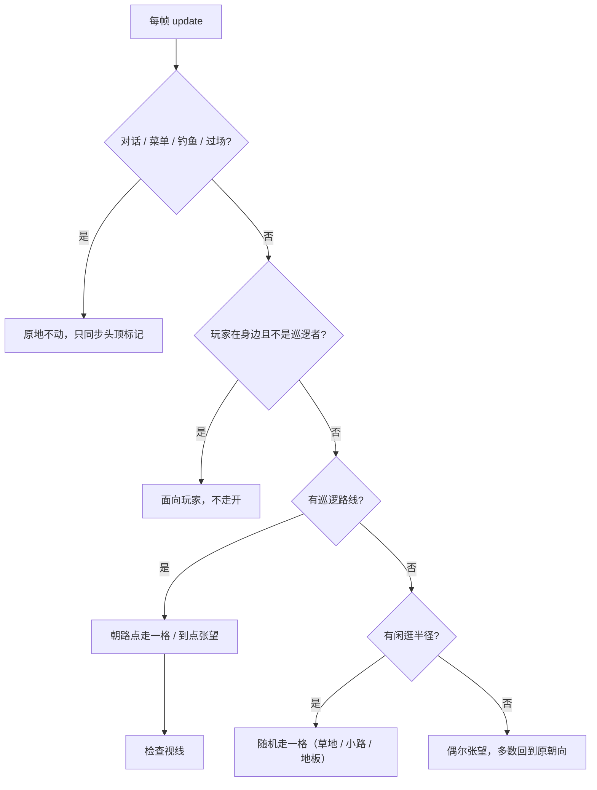
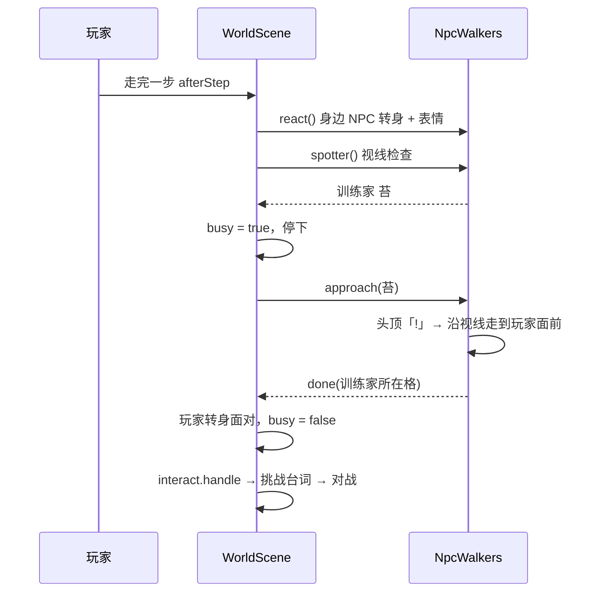
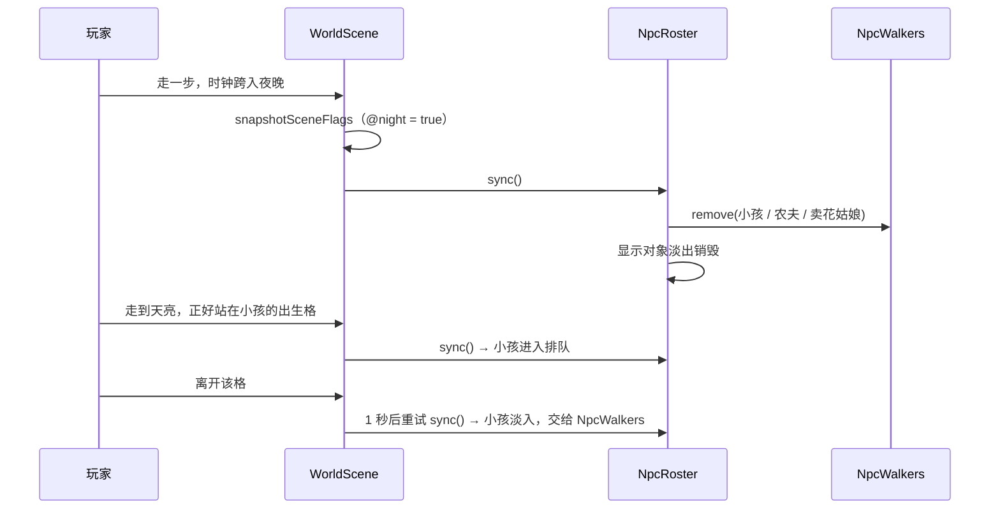
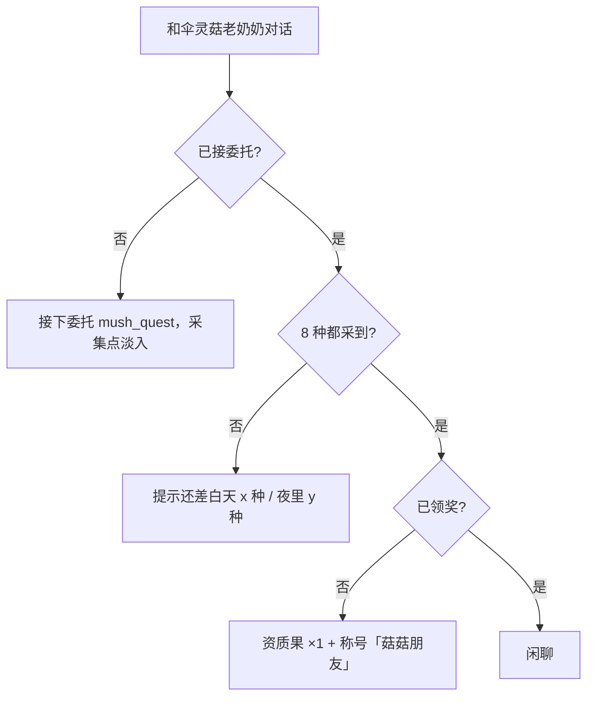

# v3.4.3 NPC 生活感：四方向行走、训练家巡逻与视线、路人、互动表情

- 作者：周建豪
- 日期：2026-10-15

## 进度

| 项 | 状态 |
|------|:--:|
| 四方向行走图（7 人）+ 处理脚本 | ✅ |
| 闲逛 / 巡逻 / 原地张望 / 转身 | ✅ |
| 训练家视线对战（苔、登山客峰） | ✅ |
| 新路人：农夫阿田、卖花姑娘铃、洗衣婶澜 | ✅ |
| 身边表情「♪ ♥ …」、被发现「!」 | ✅ |
| 单测 + 回归 + 浏览器 + 报告 | ✅ |

## 1. 美术

- AI 生成 3 列 × 4 行网格（品红底），原图放 `art-src/chars/actors/<名称>.jpg`。
- `scripts/process-actors.py`：只取每行第 1 列的站立帧；侧面行朝向不可靠，只用第 3 行并镜像出另一侧；三方向共用缩放；迈步帧沿用 `make-walk-frames.py` 算法。输出 `public/assets/chars/actor-<名称>.png`（下 / 上 / 左 / 右 × 3 帧）。
- 映射表 `NPC_ACTOR`（`graphics/CharArt.ts`）：elder、kid、ranger（苔三处共用）、hiker、farmer、florist、washer。

## 2. 数据字段（`NpcDef`）

| 字段 | 含义 |
|------|------|
| `wander` | 闲逛半径（曼哈顿距离） |
| `facing` | 初始朝向 |
| `patrol` / `patrolLook` | 巡逻路点（直线往返）/ 到点张望方向 |
| `sight` | 训练家视线格数（未击败时生效） |
| `emote` | 玩家停在身边时冒出的表情 |

## 3. 行为流程

## 4. 规则与边界

- 视线：正前方 `sight` 格内，途中遇到墙 / 水 / 岩石 / 装饰 / 其他 NPC 即被挡住；训练家已被击败、玩家没有可战伙伴、或正在对话 / 移动时不触发。
- 巡逻训练家走动时也会查视线（玩家原地不动也可能被发现）。
- 剧情关键 NPC（泉守汐、连战斥候、林语鹿等）不动，避免影响剧情触发与一键回归。
- 只有正面图的 NPC 仍可闲逛（正面迈步），但不会转身。

## 5. 与设计稿的偏差

- 无。

## 6. v3.4.4 续做（2026-10-15）

| 项 | 状态 |
|------|:--:|
| 二三章 NPC 四方向图：澈、斥候澄 / 漆、巡林者、绯（`COL` 配置修正 AI 画错的列） | ✅ |
| 新巡逻训练家：湖畔「渔家少女汀」Lv15-16、回音林「采药人柏」Lv21-22 | ✅ |
| 路人日程：`hideIf` 支持数组与 `@night` / `@rain`（进图快照，城镇天气跟随青苔草地） | ✅ |
| 视线范围提示：未击败训练家正前方画淡红色格子，越远越淡 | ✅ |

- 回归脚本开局把四位视线训练家都标记为已击败，避免巡逻拦截脚本。

## 7. v3.4.5 第三轮（2026-10-15）

| 项 | 状态 |
|------|:--:|
| 日程实时生效：同一张图里天黑 / 天亮 / 下雨时路人淡出回家、淡入出门（`NpcRoster`） | ✅ |
| 伞灵菇老奶奶四方向图 + 支线 S3-2「菇菇派对」（8 种菇：昼 4 / 夜 4） | ✅ |
| 新道具「资质果」：指定一项资质 +2（上限 20，每只最多 5 次） | ✅ |
| 训练家再战：击败 2 天后可再战，头顶「再」，等级随队伍成长 | ✅ |
| 路人闲聊：相距 1～2 格的路人面对面冒短句 / 表情 | ✅ |
| 单测 B-01～B-09 + 回归 + 浏览器 + 报告 | ✅ |

### 7.1 模块

| 文件 | 职责 |
|------|------|
| `scenes/world/NpcRoster.ts` | 已生成 NPC 名册；`sync()` 对比应显示 / 已显示，淡出移除、淡入生成；出生格被占先排队（每秒重试），避免隐形挡路 |
| `scenes/world/NpcChatter.ts` | 每 2.5 秒有 45% 机率挑一对空闲路人闲聊；两人停 3.2 秒，冷却 12 秒 |
| `scenes/world/MushroomStory.ts` | 奶奶委托 / 进度 / 交付；采集点采下即淡出（`host.refreshNpcs()`，不重进地图） |
| `data/mushrooms.ts` | 8 种菇的位置、旗标 `mush_got_<id>`、`mush_quest` / `mush_done` / `title_mushroom_friend` |
| `systems/Rematch.ts` | `rematchReady`、`rematchTeam`（纯函数） |
| `ui/TalentFruitMenu.ts` | 背包 → 选伙伴 → 选资质项 |
| `scripts/process-props.py` | 从 `art-src/props/mushrooms.jpg` 切出 `public/assets/props/mush-<id>.png` |

### 7.2 数据字段新增

| 字段 | 含义 |
|------|------|
| `showIf: string \| string[]` | 数组时需全部满足（夜晚发光菇 = `[mush_quest, @night]`） |
| `chat` | 闲聊短句（≤ 8 字） |
| `bob` | prop 贴图上下浮动；夜里作为微光光源 |
| `rematchDays` | 再战间隔天数（四位巡逻训练家 = 2） |

### 7.3 流程

### 7.4 规则

- 再战：`<defeatedKey>_day` 记录最近一次获胜的天数，`<defeatedKey>_rematch` 记录再战获胜次数；对手每只等级 = max(原等级 + 3 ×(次数 + 1), 玩家最高等级 − 与队尾的距离)，上限 50。旧存档没有天数记录，按第 0 天算。再战只能通过对话发起，视线不会再触发。
- 资质果：不在商店出售、战斗中不可用；鉴定前只显示星级；吃完按新资质重算能力值，HP 按最大值的增量补上。
- 闲聊只发生在都设了 `emote` 的空闲路人之间（巡逻训练家、视线训练家除外），两人需在同一行或同一列。
