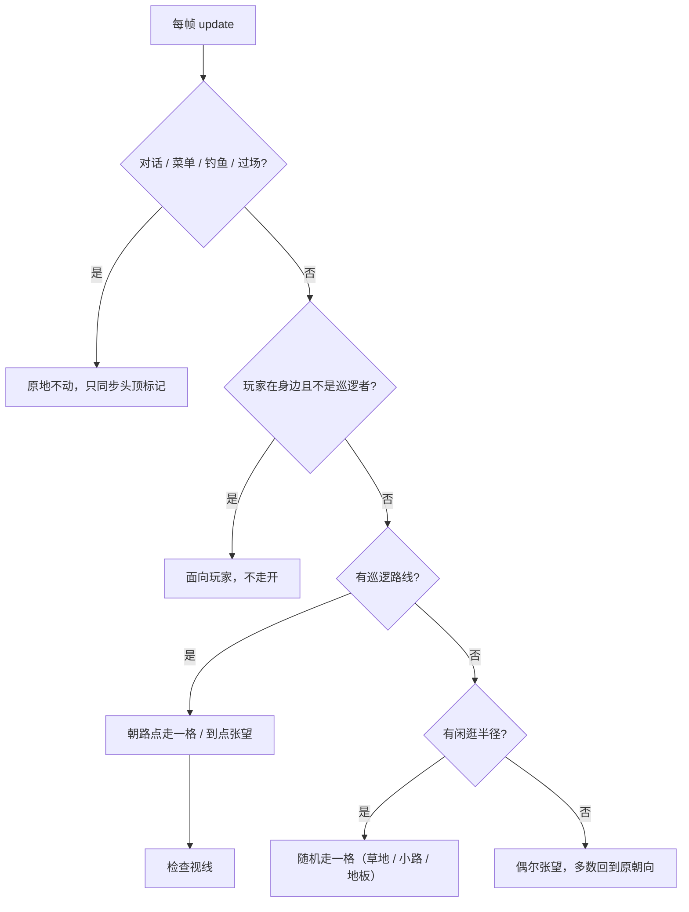
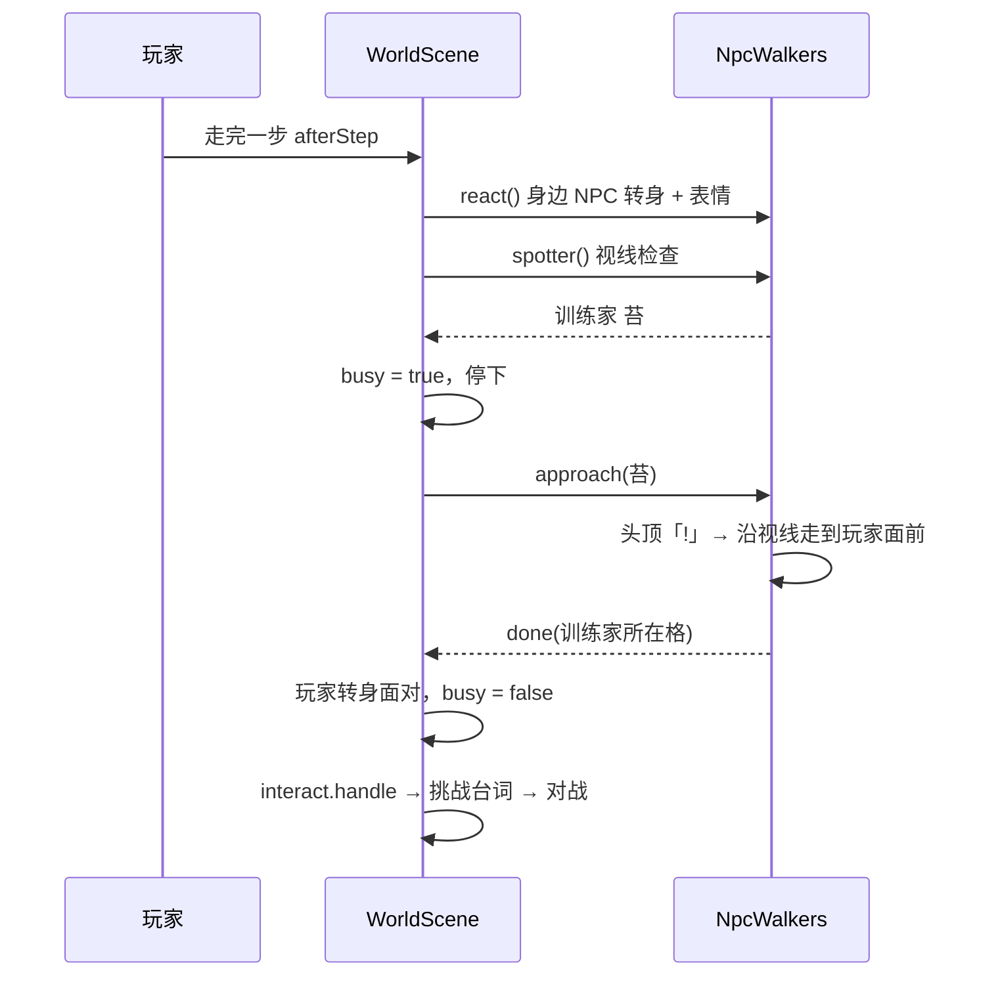

# v3.4.3 NPC 生活感：四方向行走、训练家巡逻与视线、路人、互动表情

- 作者：周建豪
- 日期：2026-10-15

## 进度

| 项 | 状态 |
|------|:--:|
| 四方向行走图（7 人）+ 处理脚本 | ✅ |
| 闲逛 / 巡逻 / 原地张望 / 转身 | ✅ |
| 训练家视线对战（苔、登山客峰） | ✅ |
| 新路人：农夫阿田、卖花姑娘铃、洗衣婶澜 | ✅ |
| 身边表情「♪ ♥ …」、被发现「!」 | ✅ |
| 单测 + 回归 + 浏览器 + 报告 | ✅ |

## 1. 美术

- AI 生成 3 列 × 4 行网格（品红底），原图放 `art-src/chars/actors/<名称>.jpg`。
- `scripts/process-actors.py`：只取每行第 1 列的站立帧；侧面行朝向不可靠，只用第 3 行并镜像出另一侧；三方向共用缩放；迈步帧沿用 `make-walk-frames.py` 算法。输出 `public/assets/chars/actor-<名称>.png`（下 / 上 / 左 / 右 × 3 帧）。
- 映射表 `NPC_ACTOR`（`graphics/CharArt.ts`）：elder、kid、ranger（苔三处共用）、hiker、farmer、florist、washer。

## 2. 数据字段（`NpcDef`）

| 字段 | 含义 |
|------|------|
| `wander` | 闲逛半径（曼哈顿距离） |
| `facing` | 初始朝向 |
| `patrol` / `patrolLook` | 巡逻路点（直线往返）/ 到点张望方向 |
| `sight` | 训练家视线格数（未击败时生效） |
| `emote` | 玩家停在身边时冒出的表情 |

## 3. 行为流程

## 4. 规则与边界

- 视线：正前方 `sight` 格内，途中遇到墙 / 水 / 岩石 / 装饰 / 其他 NPC 即被挡住；训练家已被击败、玩家没有可战伙伴、或正在对话 / 移动时不触发。
- 巡逻训练家走动时也会查视线（玩家原地不动也可能被发现）。
- 剧情关键 NPC（泉守汐、连战斥候、林语鹿等）不动，避免影响剧情触发与一键回归。
- 只有正面图的 NPC 仍可闲逛（正面迈步），但不会转身。

## 5. 与设计稿的偏差

- 无。
