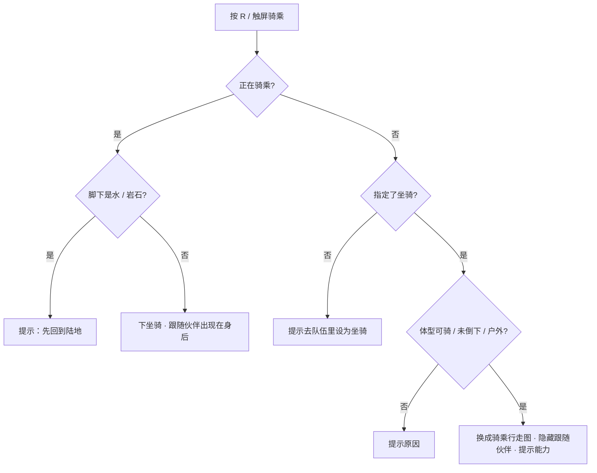
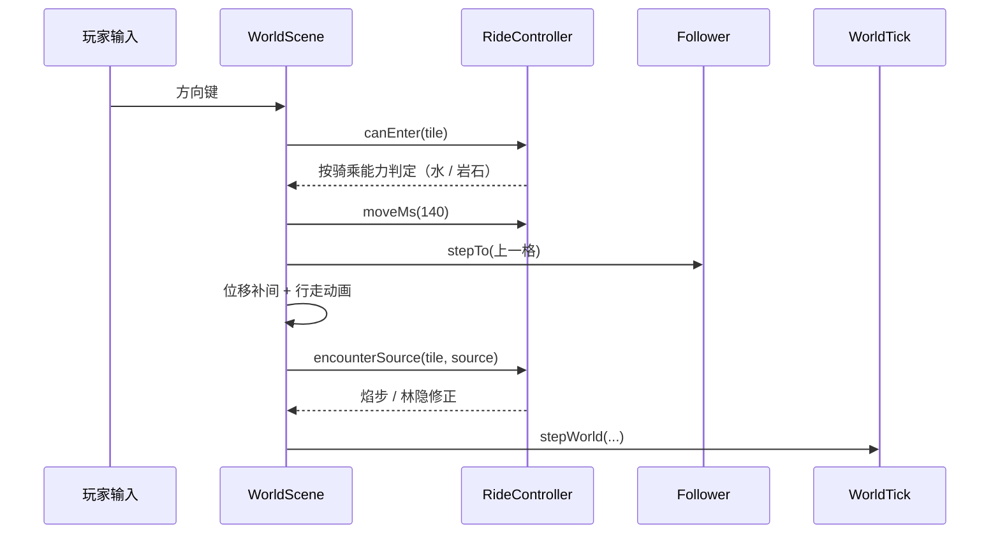

# v3.5 伙伴跟随与骑乘 · 设计文档

**作者：** 周建豪  
**日期：** 2026-10-15  
**状态：** 已完成（自测通过，报告见 `test_report_20261015_1605.md`）

## 进度

| 模块 | 内容 | 状态 |
|---|---|---|
| 美术 | 7 种坐骑骑乘行走图（AI 生成 → `scripts/process-mounts.py` → 48×48 四方向 × 3 帧） | ✅ |
| 数据 | `data/mounts.ts`：坐骑物种、骑乘能力、解锁旗标、速度 | ✅ |
| 规则 | `systems/Ride.ts`：骑乘条件、通行、下坐骑、遇敌修正、移动时长 | ✅ |
| 状态 | `state/Companions.ts`：跟随 / 坐骑 / 骑乘中（存档旗标） | ✅ |
| 表现 | `scenes/world/Follower.ts`、`scenes/world/RideController.ts` | ✅ |
| 输入 | R 键 + 触屏「骑乘」 | ✅ |
| 菜单 | 伙伴详情「设为跟随伙伴 / 设为坐骑」，队伍列表「[随] [骑]」标记 | ✅ |
| 测试 | `tests/ride-follow.test.ts` R-01 ~ R-10，浏览器自测，剧情回归 17/17 | ✅ |

## 1. 需求（用户确认）

| 问题 | 选择 |
|---|---|
| 谁跟随 | 队伍里单独指定一只「跟随伙伴」 |
| 谁能骑 | 只有体型大的伙伴 |
| 骑乘效果 | 按属性 / 物种不同 |
| 美术 | AI 生成骑乘图 |
| 操作 | R 键 + 触屏按钮；室内 / 城镇自动下来 |

## 2. 坐骑与能力

| 物种 | 属性 | 能力 | 效果 | 解锁 | 速度 |
|---|---|---|---|---|---|
| 炽角兔 / 焰冕兔 | 焰 | 焰步 | 灰烬草不遇敌；夜里提灯半径 84 → 124 | — | ×1.8 / ×2 |
| 涌潮龟 / 沧甲龟 | 潮 | 踏浪 | 可在水面行走 | 击败沧澜鲸 `whale_beaten` | ×1.5 / ×1.6 |
| 森冠狐 / 万木狐 | 叶 | 林隐 | 高草遇敌机率减半 | — | ×1.8 / ×2 |
| 岩鬃犬 | 岩 | 攀岩 | 可翻过岩石 | 击败熔鬃狮 `boss_beaten` | ×1.7 |

守护兽不可收服，不在坐骑之列。未解锁时仍可骑乘（只加速），撞到水 / 岩石会提示解锁条件。

## 3. 状态存储

不改存档结构，用已有的旗标（值可以是字符串）：

| 旗标 | 值 | 说明 |
|---|---|---|
| `pet_follow` | 伙伴 uid | 跟随伙伴 |
| `pet_mount` | 伙伴 uid | 坐骑（必须是可骑乘物种） |
| `pet_riding` | true | 骑乘中；切图 / 战斗后保持 |

伙伴离开队伍（寄存）后，`Companions.follower()` / `mount()` 找不到 uid 自动返回 null；进化后 uid 不变，坐骑跟着进化。

## 4. 流程

## 5. 表现细节

- 骑乘时玩家贴图换成 `mount-<物种>`（48×48），脚底锚点与走路起伏按 48 帧高计算；行走动画帧率随速度加快。
- 影子骑乘时加宽；上下坐骑时脚下扬起一圈尘土。
- 跟随伙伴用战斗立绘缩小（0.62 × 进化阶段倍率），立绘朝左，往右走时翻转；每步小跳 3px；在玩家南侧时盖在玩家上层，其余在下层；不占格子。
- 面对跟随伙伴按确认：冒「♥」并按亲密度给出三档回应。
- 进入室内 / 城镇（`outdoor: false`）时自动下坐骑；菜单关闭后同步跟随 / 坐骑变化。
- 骑乘中不能在菜单里更换或取消坐骑（避免在水上被强制下来）。

## 6. 文件

| 文件 | 说明 |
|---|---|
| `art-src/mounts/*.jpg` | AI 原图 |
| `scripts/process-mounts.py` | 抠图、缩放、镜像出右向、输出 576×48 行走图 |
| `src/game/data/mounts.ts` | 坐骑数据 |
| `src/game/systems/Ride.ts` | 纯规则 |
| `src/game/state/Companions.ts` | 同行状态 |
| `src/game/scenes/world/Follower.ts` | 跟随伙伴 |
| `src/game/scenes/world/RideController.ts` | 骑乘控制 |
| `src/game/ui/CompanionRows.ts` | 菜单行 |

## 7. 测试用例

| 编号 | 用例 | 预期 |
|---|---|---|
| R-01 | 坐骑数据 | 都是可收服物种，速度 > 1，行走图存在 |
| R-02 | 骑乘条件 | 未指定 / 体型小 / 倒下 / 室内都给出原因 |
| R-03 | 能力解锁 | 踏浪需 whale_beaten，攀岩需 boss_beaten |
| R-04 | 通行 | 水需踏浪，岩石需攀岩，墙永不可走 |
| R-05 | 下坐骑 | 水面 / 岩石上不能下 |
| R-06 | 焰步 | 灰烬草不遇敌 |
| R-07 | 林隐 | 高草一半机率不遇敌 |
| R-08 | 速度 | 骑乘更快，步行不变 |
| R-09 | 同行状态 | 设定 / 取消；取消坐骑时一并下来 |
| R-10 | 离队失效 | 伙伴离队后跟随 / 坐骑失效；小体型不能当坐骑 |
| UI-01 | 跟随（浏览器） | 伙伴走在身后一格、朝向正确 |
| UI-02 | 骑乘（浏览器） | 换骑乘图、加速、跟随伙伴隐藏 |
| UI-03 | 踏浪（浏览器） | 未解锁提示；解锁后可下水，水上不能下来 |
| UI-04 | 城镇（浏览器） | 进城自动下来；R 提示「这里不方便骑乘」；面对伙伴冒爱心 |
| UI-05 | 战斗往返（浏览器） | 骑乘状态保持 |
| UI-06 | 夜晚焰步（浏览器） | 灰烬草不遇敌，提灯半径变大 |
