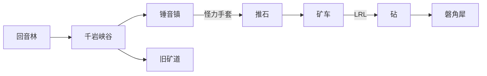

# v3.6 第四章 · 磐谷 · 设计文档

**作者：** 周建豪  
**日期：** 2026-10-16  
**状态：** 主线已完成（报告见 `test_report_20261016_1355.md`）

## 进度

| 模块 | 内容 | 状态 |
|---|---|---|
| 地图 | 锤音镇、千岩峡谷、旧矿道；回音林东口 | ✅ |
| 推石 | 怪力手套 + 岩/一般系；三段由南向北 | ✅ |
| 矿车 | 三个道岔，LRL 进深处，LLL / RRR 有箱子 | ✅ |
| 战斗 | 掘手·砧、磐角犀（地鸣） | ✅ |
| 奖励 | 岩之徽记、旧徽章、甲纹龟（三块化石） | ✅ |
| 未做 | 锤铺学徒、矿车竞速；新伙伴立绘仍是程序绘制 | ⏳ |

## 1. 怎么走

第三章打完林语鹿后，回音林北段东边的山路打开（`canyon_unlocked`）。

峡谷从南往北必须按顺序推开三处，不能绕：

| 区 | 做法 | 打开 |
|---|---|---|
| 1 | 把石头向北推进裂缝 | (10,10) |
| 2 | 两块石头分别压上两块踏板 | 石门 (10,6) |
| 3 | 三块石头推进北墙裂缝 | 通往矿道 |

入口木牌可以把石头推回原位。水面和岩石的骑乘能力过不了这些墙。

## 2. 矿车

三个道岔默认都朝左（L）。面朝道岔按确认会左右调换。

| 路线 | 结果 |
|---|---|
| LRL | 矿道深处，遇见砧 |
| LLL | 好伤药 ×2（只拿一次） |
| RRR | 引兽铃（只拿一次） |
| 其他 | 撞上缓冲木，停在原地 |

## 3. 旗标

`canyon_unlocked`、`canyon_gloves`、`canyon_deep`、`anvil_beaten`、`rhino_beaten`、`badge_stone`、`chapter4_done`、`canyon_fossil_a/b/c`、`canyon_fossil_done`。巨石位置存在 `boulder_z1` 等旗标里（`x,y` 或 `sunk`）。
